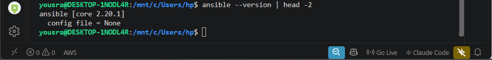
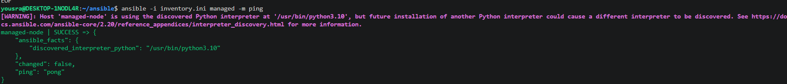
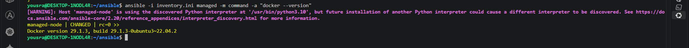

# Lab 24: Initial Ansible Configuration and Ad-Hoc Execution

## Goal

- Install and configure Ansible on the control node.
- Generate a new SSH key on the control node.
- Copy the public key to the managed node with `ssh-copy-id`.
- Create an inventory of the managed node.
- Run an ad-hoc command to install Docker.

## Environment

Both nodes are Ubuntu distributions on the same Windows machine (WSL2).

| Role | Distribution | User | Notes |
|------|--------------|------|-------|
| Control node | Ubuntu 26.04 (WSL2) | `yousra` | Ansible runs here (the machine that also runs the Kubernetes cluster and Jenkins) |
| Managed node | Ubuntu 22.04 (WSL2), hostname `managed-node` | `yosra` | A second WSL distribution, created with `wsl --install -d Ubuntu-22.04` |

WSL2 distributions share the same network, so both nodes have the IP `172.30.194.27`, and the managed node is reached on its SSH port 22.

### Preparing the managed node

SSH server, systemd and a passwordless `sudo` are needed on the managed node:

```bash
# /etc/wsl.conf (then: wsl --terminate Ubuntu-22.04 from PowerShell)
[boot]
systemd=true

[network]
hostname=managed-node
```
```bash
sudo apt update && sudo apt install -y openssh-server
sudo systemctl enable --now ssh
echo "yosra ALL=(ALL) NOPASSWD:ALL" | sudo tee /etc/sudoers.d/yosra
sudo chmod 440 /etc/sudoers.d/yosra
```

The SSH service is `active (running)` and the hostname is `managed-node`.

## 1) Install Ansible on the control node

```bash
sudo apt update && sudo apt install -y ansible
ansible --version | head -2
```
```
ansible [core 2.20.1]
  config file = None
```



## 2) Generate a new SSH key

```bash
ssh-keygen -t ed25519 -f ~/.ssh/id_ed25519_ansible -N ""
```
```
Your identification has been saved in /home/yousra/.ssh/id_ed25519_ansible
Your public key has been saved in /home/yousra/.ssh/id_ed25519_ansible.pub
```

A dedicated key is used so the other SSH keys of the machine are not touched. `-N ""` creates it without a passphrase, so Ansible can use it without asking.

## 3) Transfer the public key to the managed node

```bash
ssh-copy-id -i ~/.ssh/id_ed25519_ansible.pub yosra@172.30.194.27
```
```
Number of key(s) added: 1

Now try logging into the machine, with: "ssh -i /home/yousra/.ssh/id_ed25519_ansible 'yosra@172.30.194.27'"
```

Login with the key works without a password:

```bash
ssh -i ~/.ssh/id_ed25519_ansible yosra@172.30.194.27 hostname
```
```
managed-node
```

## 4) Create the inventory

[`inventory.ini`](./inventory.ini):

```ini
[managed]
managed-node ansible_host=172.30.194.27 ansible_user=yosra ansible_ssh_private_key_file=~/.ssh/id_ed25519_ansible
```

Test the connection with the `ping` module (it checks SSH and Python, it is not an ICMP ping):

```bash
ansible -i inventory.ini managed -m ping
```
```
managed-node | SUCCESS => {
    "ansible_facts": {
        "discovered_interpreter_python": "/usr/bin/python3.10"
    },
    "changed": false,
    "ping": "pong"
}
```

The warning about the discovered Python interpreter is shown by Ansible and does not affect the result.



## 5) Install Docker with an ad-hoc command

```bash
ansible -i inventory.ini managed -m apt -a "name=docker.io state=present update_cache=yes" --become
```
- `-m apt` is the module and `-a` its arguments.
- `--become` runs the command with `sudo` on the managed node.
- `state=present` installs the package if it is not installed.

The result is `managed-node | CHANGED` (the output ends with `Setting up docker.io (29.1.3-0ubuntu3~22.04.2) ...` and the symlinks of `docker.service` and `docker.socket`).

Check the installed version:

```bash
ansible -i inventory.ini managed -m command -a "docker --version"
```
```
managed-node | CHANGED | rc=0 >>
Docker version 29.1.3, build 29.1.3-0ubuntu3~22.04.2
```



## Notes

- The package is `docker.io` from the Ubuntu repository. It is a different Docker than the Docker Desktop that runs the containers of the previous labs, and it runs only inside the managed node.
- The `command` module reports `CHANGED` even for a read-only command like `docker --version`. It does not know the command did not change anything.
- The modules used are idempotent: running the `apt` command again gives `"changed": false`.
