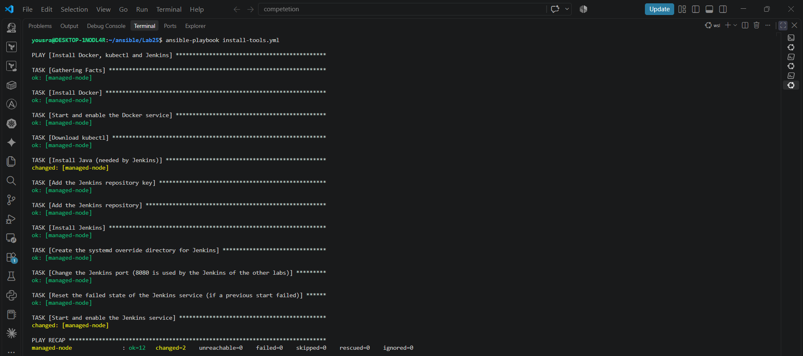
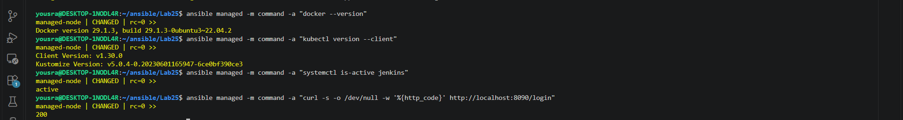

# Lab 25: Automated Configuration Using Ansible Playbooks

## Goal

Write an Ansible playbook that installs Docker, kubectl and Jenkins on the managed node, and verify the configuration on that node.

## Environment

Same setup as [Lab 24](../Lab24): the control node is the Ubuntu WSL distribution that runs Ansible, and the managed node is a second WSL distribution (Ubuntu 22.04, hostname `managed-node`, user `yosra`) reached by SSH key.

Files in this folder:

| File | Purpose |
|------|---------|
| [`install-tools.yml`](./install-tools.yml) | The playbook |
| [`inventory.ini`](./inventory.ini) | The managed node |
| [`ansible.cfg`](./ansible.cfg) | Default inventory, and `interpreter_python = auto_silent` (hides the Python interpreter warning) |

## The playbook

```yaml
---
- name: Install Docker, kubectl and Jenkins
  hosts: managed
  become: true

  vars:
    kubectl_version: v1.30.0
    jenkins_port: 8090

  tasks:
    # ---------- Docker ----------
    - name: Install Docker
      ansible.builtin.apt:
        name: docker.io
        state: present
        update_cache: true

    - name: Start and enable the Docker service
      ansible.builtin.service:
        name: docker
        state: started
        enabled: true

    # ---------- kubectl ----------
    - name: Download kubectl
      ansible.builtin.get_url:
        url: "https://dl.k8s.io/release/{{ kubectl_version }}/bin/linux/amd64/kubectl"
        checksum: "sha256:https://dl.k8s.io/release/{{ kubectl_version }}/bin/linux/amd64/kubectl.sha256"
        dest: /usr/local/bin/kubectl
        mode: "0755"

    # ---------- Jenkins ----------
    - name: Install Java (needed by Jenkins)
      ansible.builtin.apt:
        name: openjdk-21-jre
        state: present

    - name: Add the Jenkins repository key
      ansible.builtin.get_url:
        url: https://pkg.jenkins.io/debian-stable/jenkins.io-2026.key
        dest: /usr/share/keyrings/jenkins-keyring.asc
        mode: "0644"
        force: true

    - name: Add the Jenkins repository
      ansible.builtin.apt_repository:
        repo: "deb [signed-by=/usr/share/keyrings/jenkins-keyring.asc] https://pkg.jenkins.io/debian-stable binary/"
        filename: jenkins
        state: present

    - name: Install Jenkins
      ansible.builtin.apt:
        name: jenkins
        state: present
        update_cache: true

    - name: Create the systemd override directory for Jenkins
      ansible.builtin.file:
        path: /etc/systemd/system/jenkins.service.d
        state: directory
        mode: "0755"

    - name: Change the Jenkins port (8080 is used by the Jenkins of the other labs)
      ansible.builtin.copy:
        dest: /etc/systemd/system/jenkins.service.d/override.conf
        content: |
          [Service]
          Environment="JENKINS_PORT={{ jenkins_port }}"
        mode: "0644"
      notify: Restart Jenkins

    - name: Reset the failed state of the Jenkins service (if a previous start failed)
      ansible.builtin.command: systemctl reset-failed jenkins
      changed_when: false
      failed_when: false

    - name: Start and enable the Jenkins service
      ansible.builtin.systemd:
        name: jenkins
        state: started
        enabled: true
        daemon_reload: true

  handlers:
    - name: Restart Jenkins
      ansible.builtin.systemd:
        name: jenkins
        state: restarted
        daemon_reload: true
```

What each part does:

| Tool | Tasks |
|------|-------|
| Docker | Installs `docker.io` and starts and enables the service |
| kubectl | Downloads the binary of `v1.30.0` from `dl.k8s.io`, checks its SHA-256 checksum, and puts it in `/usr/local/bin` |
| Jenkins | Installs Java 21, adds the Jenkins repository key and repository, installs Jenkins, changes its port, and starts and enables the service |

- `become: true` runs the tasks with `sudo`.
- Jenkins runs on port **8090**, because the managed node shares the network with the other WSL distribution, where the Jenkins of the previous labs already uses 8080. The port is changed with a systemd override (`JENKINS_PORT`), and the `Restart Jenkins` handler restarts the service only when that file changes.
- The `reset-failed` task clears the failed state of the service, so a start that failed before (for example because of the wrong Java version) does not block the next start.

## Run the playbook

```bash
cd ~/ansible/Lab25
ansible-playbook install-tools.yml --syntax-check
ansible-playbook install-tools.yml
```

The result of the final run:

```
TASK [Install Java (needed by Jenkins)] ************************************************
changed: [managed-node]
...
TASK [Start and enable the Jenkins service] ********************************************
changed: [managed-node]

PLAY RECAP *****************************************************************************
managed-node               : ok=12   changed=2    unreachable=0    failed=0    skipped=0    rescued=0    ignored=0
```

The tasks that were already done in earlier runs (Docker, kubectl, the repository, the override file) show `ok` and not `changed`, which is the idempotent behavior of Ansible.



## Problems found while running it

The playbook did not pass on the first run. Two problems came from the Jenkins package, not from the managed node:

| Problem | Error | Fix |
|---------|-------|-----|
| The Jenkins repository key | `NO_PUBKEY 7198F4B714ABFC68` and `The repository ... is not signed`: the repository is now signed with a newer key than `jenkins.io-2023.key` | Use `jenkins.io-2026.key` and `force: true`, so a key that was already downloaded is replaced |
| The Java version | `Running with Java 17 ... which is older than the minimum required version (Java 21)` and Jenkins stayed failed | Install `openjdk-21-jre` (Jenkins supports Java 21 and 25), and add the `reset-failed` task |

## Verify on the managed node

The checks run from the control node with ad-hoc commands:

```bash
ansible managed -m command -a "docker --version"
```
```
managed-node | CHANGED | rc=0 >>
Docker version 29.1.3, build 29.1.3-0ubuntu3~22.04.2
```

```bash
ansible managed -m command -a "kubectl version --client"
```
```
managed-node | CHANGED | rc=0 >>
Client Version: v1.30.0
Kustomize Version: v5.0.4-0.20230601165947-6ce0bf390ce3
```

```bash
ansible managed -m command -a "systemctl is-active jenkins"
```
```
managed-node | CHANGED | rc=0 >>
active
```

```bash
ansible managed -m command -a "curl -s -o /dev/null -w '%{http_code}' http://localhost:8090/login"
```
```
managed-node | CHANGED | rc=0 >>
200
```

Docker, kubectl and Jenkins are installed, and the Jenkins login page answers with HTTP 200 on port 8090.



## Notes

- The `command` module always reports `CHANGED`, even for read-only commands like these checks. It does not know the command did not change anything.
- The Jenkins on the managed node is a fresh installation, separate from the Jenkins container of the CI/CD labs.
