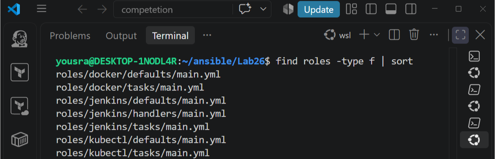
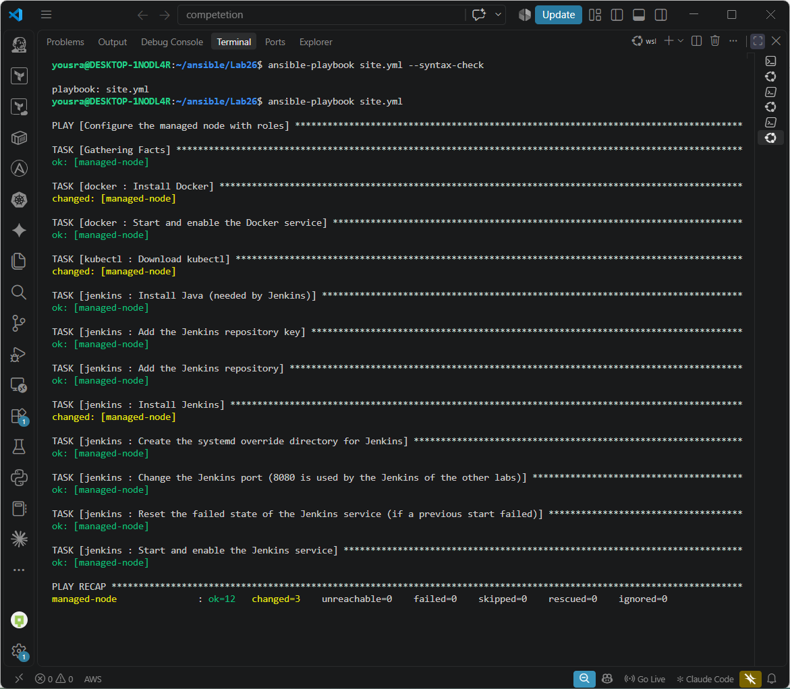
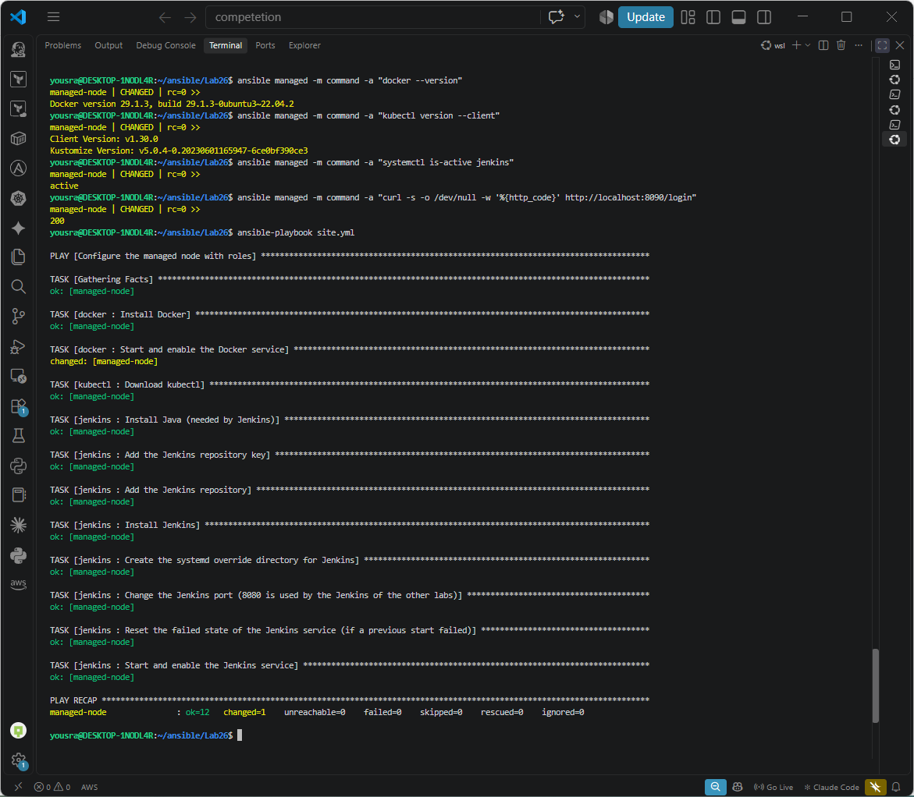

# Lab 26: Structured Configuration Management with Ansible Roles

## Goal

- Create separate Ansible roles for Docker, kubectl and Jenkins.
- Write an Ansible playbook that runs the roles.

## Environment

The same control node and managed node as in [Lab 24](../Lab24) and [Lab 25](../Lab25) (Ubuntu 22.04 WSL distribution `managed-node`, user `yosra`, SSH key).

## Structure

The tasks of Lab 25 were split into one role per tool. Each role has its own folder with `tasks/` (what to do) and `defaults/` (variables that can be overridden), and the Jenkins role also has `handlers/`.

```
Lab26
├── ansible.cfg
├── inventory.ini
├── site.yml                      (the playbook that runs the roles)
└── roles
    ├── docker
    │   ├── defaults/main.yml
    │   └── tasks/main.yml
    ├── kubectl
    │   ├── defaults/main.yml
    │   └── tasks/main.yml
    └── jenkins
        ├── defaults/main.yml
        ├── handlers/main.yml
        └── tasks/main.yml
```

```bash
find roles -type f | sort
```
```
roles/docker/defaults/main.yml
roles/docker/tasks/main.yml
roles/jenkins/defaults/main.yml
roles/jenkins/handlers/main.yml
roles/jenkins/tasks/main.yml
roles/kubectl/defaults/main.yml
roles/kubectl/tasks/main.yml
```



## The playbook

[`site.yml`](./site.yml):

```yaml
---
- name: Configure the managed node with roles
  hosts: managed
  become: true
  roles:
    - docker
    - kubectl
    - jenkins
```

The playbook has no tasks of its own: it only lists the roles and the order they run in. Variables such as the kubectl version or the Jenkins port are in each role's `defaults/main.yml`, so they can be changed from one place or overridden when the playbook runs (for example `-e jenkins_port=9090`).

## The roles

### docker

`roles/docker/defaults/main.yml`
```yaml
---
docker_package: docker.io
```

`roles/docker/tasks/main.yml`
```yaml
---
- name: Install Docker
  ansible.builtin.apt:
    name: "{{ docker_package }}"
    state: present
    update_cache: true

- name: Start and enable the Docker service
  ansible.builtin.service:
    name: docker
    state: started
    enabled: true
```

### kubectl

`roles/kubectl/defaults/main.yml`
```yaml
---
kubectl_version: v1.30.0
kubectl_dest: /usr/local/bin/kubectl
```

`roles/kubectl/tasks/main.yml`
```yaml
---
- name: Download kubectl
  ansible.builtin.get_url:
    url: "https://dl.k8s.io/release/{{ kubectl_version }}/bin/linux/amd64/kubectl"
    checksum: "sha256:https://dl.k8s.io/release/{{ kubectl_version }}/bin/linux/amd64/kubectl.sha256"
    dest: "{{ kubectl_dest }}"
    mode: "0755"
```

### jenkins

`roles/jenkins/defaults/main.yml`
```yaml
---
jenkins_port: 8090
jenkins_java_package: openjdk-21-jre
```

`roles/jenkins/handlers/main.yml`
```yaml
---
- name: Restart Jenkins
  ansible.builtin.systemd:
    name: jenkins
    state: restarted
    daemon_reload: true
```

`roles/jenkins/tasks/main.yml`
```yaml
---
- name: Install Java (needed by Jenkins)
  ansible.builtin.apt:
    name: "{{ jenkins_java_package }}"
    state: present
    update_cache: true

- name: Add the Jenkins repository key
  ansible.builtin.get_url:
    url: https://pkg.jenkins.io/debian-stable/jenkins.io-2026.key
    dest: /usr/share/keyrings/jenkins-keyring.asc
    mode: "0644"
    force: true

- name: Add the Jenkins repository
  ansible.builtin.apt_repository:
    repo: "deb [signed-by=/usr/share/keyrings/jenkins-keyring.asc] https://pkg.jenkins.io/debian-stable binary/"
    filename: jenkins
    state: present

- name: Install Jenkins
  ansible.builtin.apt:
    name: jenkins
    state: present
    update_cache: true

- name: Create the systemd override directory for Jenkins
  ansible.builtin.file:
    path: /etc/systemd/system/jenkins.service.d
    state: directory
    mode: "0755"

- name: Change the Jenkins port (8080 is used by the Jenkins of the other labs)
  ansible.builtin.copy:
    dest: /etc/systemd/system/jenkins.service.d/override.conf
    content: |
      [Service]
      Environment="JENKINS_PORT={{ jenkins_port }}"
    mode: "0644"
  notify: Restart Jenkins

- name: Reset the failed state of the Jenkins service (if a previous start failed)
  ansible.builtin.command: systemctl reset-failed jenkins
  changed_when: false
  failed_when: false

- name: Start and enable the Jenkins service
  ansible.builtin.systemd:
    name: jenkins
    state: started
    enabled: true
    daemon_reload: true
```

The Jenkins role uses the key `jenkins.io-2026.key` and Java 21, which are the ones the current Jenkins package needs (see the problems found in Lab 25). Jenkins runs on port **8090**, because port 8080 is used by the Jenkins of the other labs on the same machine.

## Run the roles

To show that the roles do the installation, Docker, Jenkins and kubectl were removed from the managed node first (with ad-hoc commands), and the checks fail as expected:

```bash
ansible managed -b -m apt -a "name=jenkins,docker.io state=absent purge=true"
ansible managed -b -m file -a "path=/usr/local/bin/kubectl state=absent"
```
```
ansible managed -m command -a "docker --version"        -> No such file or directory: b'docker'
ansible managed -m command -a "kubectl version --client" -> No such file or directory: b'kubectl'
ansible managed -m command -a "systemctl is-active jenkins" -> inactive
```

Then the playbook with the roles was run:

```bash
cd ~/ansible/Lab26
ansible-playbook site.yml --syntax-check
ansible-playbook site.yml
```
```
TASK [docker : Install Docker] *************************************************************************************************
changed: [managed-node]
TASK [docker : Start and enable the Docker service] ****************************************************************************
ok: [managed-node]
TASK [kubectl : Download kubectl] **********************************************************************************************
changed: [managed-node]
TASK [jenkins : Install Java (needed by Jenkins)] ******************************************************************************
ok: [managed-node]
...
TASK [jenkins : Install Jenkins] ***********************************************************************************************
changed: [managed-node]
...
PLAY RECAP *********************************************************************************************************************
managed-node               : ok=12   changed=3    unreachable=0    failed=0    skipped=0    rescued=0    ignored=0
```

The task names start with the role name (`docker : ...`, `kubectl : ...`, `jenkins : ...`), which shows which role ran each task.



## Verify on the managed node

```bash
ansible managed -m command -a "docker --version"
```
```
managed-node | CHANGED | rc=0 >>
Docker version 29.1.3, build 29.1.3-0ubuntu3~22.04.2
```
```bash
ansible managed -m command -a "kubectl version --client"
```
```
managed-node | CHANGED | rc=0 >>
Client Version: v1.30.0
Kustomize Version: v5.0.4-0.20230601165947-6ce0bf390ce3
```
```bash
ansible managed -m command -a "systemctl is-active jenkins"
```
```
managed-node | CHANGED | rc=0 >>
active
```
```bash
ansible managed -m command -a "curl -s -o /dev/null -w '%{http_code}' http://localhost:8090/login"
```
```
managed-node | CHANGED | rc=0 >>
200
```



## Running it again

```bash
ansible-playbook site.yml
```
```
TASK [docker : Install Docker] ****************************************************
ok: [managed-node]
TASK [docker : Start and enable the Docker service] *******************************
changed: [managed-node]
...
PLAY RECAP *********************************************************************************************************************
managed-node               : ok=12   changed=1    unreachable=0    failed=0    skipped=0    rescued=0    ignored=0
```

Eleven tasks are `ok` and nothing is installed again. One task, **Start and enable the Docker service**, reported `changed`: Ansible had to start or enable the Docker service at that moment, so the service was not in the wanted state, and the playbook put it there. A new run shows no changes when everything is already in the wanted state.


## Notes

- Roles keep the playbook short and let each tool be reused alone, for example `roles: [docker]` in another playbook.
- A role is applied to a host by listing it under `roles:`; the roles run in the order they are listed.
- The Jenkins on the managed node is a fresh installation, separate from the Jenkins container of the CI/CD labs.
