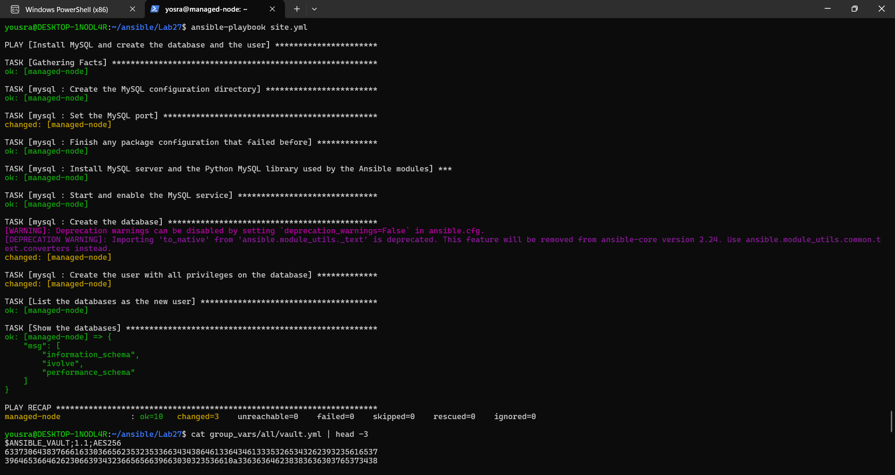
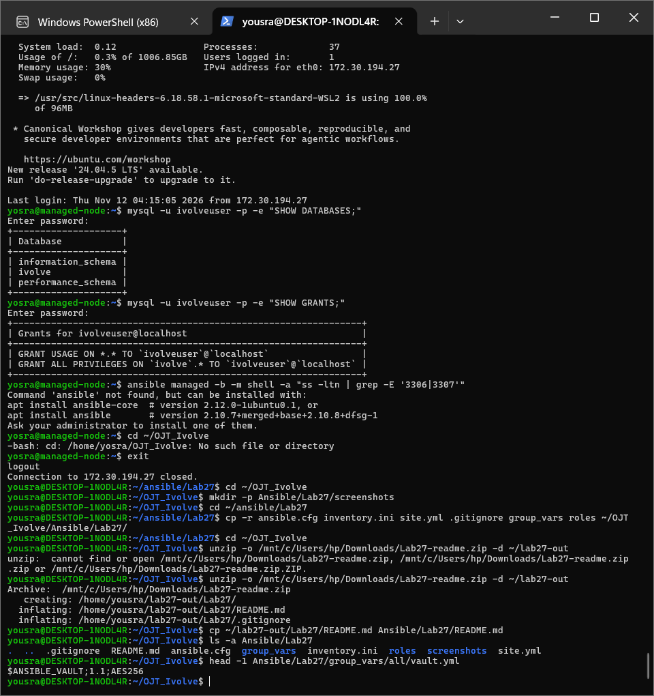

# Lab 27: Securing Sensitive Data with Ansible Vault

## Goal

- Create a MySQL role that installs MySQL, creates the `ivolve` database, and creates the user `ivolveuser` with all privileges on it.
- Use Ansible Vault to encrypt the sensitive information (the database user password).
- Validate the database on the managed node by connecting with the new user and listing the databases.

The task writes the database name as `ivovle` in one place and `ivolve` in another. The name `ivolve` is used, like the rest of the course.

## Environment

The same control node and managed node as in the previous Ansible labs (the managed node is an Ubuntu 22.04 WSL distribution, user `yosra`, reached by SSH key).

```
Lab27
├── ansible.cfg
├── inventory.ini
├── site.yml                      (the playbook)
├── .gitignore                    (keeps the vault password file out of Git)
├── group_vars
│   └── all
│       ├── vars.yml              (non-sensitive variables)
│       └── vault.yml             (ENCRYPTED: the database password)
└── roles
    └── mysql
        ├── defaults/main.yml
        └── tasks/main.yml
```

## Ansible Vault

Two passwords are involved, and they are different:

| Password | Purpose | Where it is |
|----------|---------|-------------|
| Vault password | Encrypts and decrypts the vault file | In `.vault_pass` on the control node only. **Not committed** (it is in `.gitignore`) |
| Database password | The password of the MySQL user `ivolveuser` | Inside the encrypted `group_vars/all/vault.yml` |

Both were typed with `read -rsp`, so they do not appear on the screen or in the shell history:

```bash
read -rsp "Vault password: " VP; echo
printf '%s' "$VP" > .vault_pass; chmod 600 .vault_pass; unset VP

read -rsp "DB password: " DBPASS; echo
printf 'vault_db_password: "%s"\n' "$DBPASS" > group_vars/all/vault.yml; unset DBPASS

ansible-vault encrypt group_vars/all/vault.yml
```

The encrypted file does not show the password:

```bash
cat group_vars/all/vault.yml | head -3
```
```
$ANSIBLE_VAULT;1.1;AES256
63373064383766616330366562353235336634343864613364346133353265343262393235616537
3964653664626230663934323665656639663030323536610a336363646238383636303765373438
```


`ansible.cfg` tells Ansible where the vault password is, so the commands do not ask for it:

```ini
[defaults]
inventory = inventory.ini
interpreter_python = auto_silent
# The vault password is read from this file (it is NOT committed, see .gitignore)
vault_password_file = .vault_pass
```

The variables are split in two files. `vars.yml` is readable and only points to the vault variable:

```yaml
---
# Non-sensitive settings
mysql_db_name: ivolve
mysql_db_user: ivolveuser

# The password comes from the encrypted file group_vars/all/vault.yml
mysql_db_password: "{{ vault_db_password }}"
```

Other useful commands: `ansible-vault view group_vars/all/vault.yml` (shows the content), `ansible-vault edit ...` (changes it), and `ansible-vault rekey ...` (changes the vault password).

The encrypted `vault.yml` is safe to commit. The file `.vault_pass` is not.

## The MySQL role

`roles/mysql/defaults/main.yml`
```yaml
---
mysql_db_name: ivolve
mysql_db_user: ivolveuser
mysql_user_host: localhost
mysql_socket: /var/run/mysqld/mysqld.sock
# Port 3306 is already used on this machine (the two WSL distributions share one network),
# so MySQL listens on another port. Ansible connects through the socket, so this does not matter to it.
mysql_port: 3307
# mysql_db_password has no default on purpose: it must come from the vault
```

`roles/mysql/tasks/main.yml`
```yaml
---
# The settings are written before the installation: the package starts MySQL
# at the end of the installation, and it fails if the port is already used.
- name: Create the MySQL configuration directory
  ansible.builtin.file:
    path: /etc/mysql/mysql.conf.d
    state: directory
    mode: "0755"

- name: Set the MySQL port
  ansible.builtin.copy:
    dest: /etc/mysql/mysql.conf.d/99-ivolve.cnf
    content: |
      [mysqld]
      port = {{ mysql_port }}
      mysqlx = OFF
    mode: "0644"

- name: Finish any package configuration that failed before
  ansible.builtin.command: dpkg --configure -a
  changed_when: false

- name: Install MySQL server and the Python MySQL library used by the Ansible modules
  ansible.builtin.apt:
    name:
      - mysql-server
      - python3-pymysql
    state: present
    update_cache: true

- name: Start and enable the MySQL service
  ansible.builtin.service:
    name: mysql
    state: started
    enabled: true

- name: Create the database
  community.mysql.mysql_db:
    name: "{{ mysql_db_name }}"
    state: present
    login_unix_socket: "{{ mysql_socket }}"

- name: Create the user with all privileges on the database
  community.mysql.mysql_user:
    name: "{{ mysql_db_user }}"
    host: "{{ mysql_user_host }}"
    password: "{{ mysql_db_password }}"
    priv: "{{ mysql_db_name }}.*:ALL"
    state: present
    login_unix_socket: "{{ mysql_socket }}"
  no_log: true   # keeps the password out of the output and logs
```

- `mysql_db` and `mysql_user` (from the `community.mysql` collection) create the database and the user. They connect through the MySQL socket as root (the tasks run with `become`), so no root password is needed.
- `priv: "ivolve.*:ALL"` gives all privileges on the `ivolve` database only.
- `no_log: true` on the user task keeps the password out of the output and the logs.
- The role has no default for `mysql_db_password`, so it must come from the vault.

## The playbook

[`site.yml`](./site.yml):

```yaml
---
- name: Install MySQL and create the database and the user
  hosts: managed
  become: true

  roles:
    - mysql

  post_tasks:
    # Connect as the new user (not as root) and list the databases
    - name: List the databases as the new user
      community.mysql.mysql_query:
        login_user: "{{ mysql_db_user }}"
        login_password: "{{ mysql_db_password }}"
        login_unix_socket: /var/run/mysqld/mysqld.sock
        query: SHOW DATABASES
      register: databases
      tags: validate

    - name: Show the databases
      ansible.builtin.debug:
        msg: "{{ databases.query_result[0] | map(attribute='Database') | list }}"
      tags: validate
```

The last two tasks (tag `validate`) connect as `ivolveuser` (not as root) and list the databases.

## Problem found: port 3306 was already in use

The first run failed while installing the `mysql-server` package:

```
dpkg: error processing package mysql-server-8.0 (--configure):
 installed mysql-server-8.0 package post-installation script subprocess returned error exit status 1
```

The MySQL error log on the managed node showed why:

```
[ERROR] [MY-010262] [Server] Can't start server: Bind on TCP/IP port: Address already in use
[ERROR] [MY-010257] [Server] Do you already have another mysqld server running on port: 3306 ?
```

The two WSL distributions share one network, and the other distribution (the control node) already runs **MariaDB** on `127.0.0.1:3306`:

```bash
sudo ss -ltnp | grep 3306
```
```
LISTEN 0      80          127.0.0.1:3306       0.0.0.0:*    users:(("mariadbd",pid=437,fd=29))
```

Fix: the role writes `/etc/mysql/mysql.conf.d/99-ivolve.cnf` with `port = 3307` (and `mysqlx = OFF`) **before** installing the package, and runs `dpkg --configure -a` to finish the failed installation. Ansible and the `mysql` client connect through the socket, so the port does not change anything for them. On a normal machine the port can be left at 3306.

## Run the playbook

```bash
cd ~/ansible/Lab27
ansible-playbook site.yml --syntax-check
ansible-playbook site.yml
```
```
TASK [mysql : Set the MySQL port] **********************************************
changed: [managed-node]
TASK [mysql : Finish any package configuration that failed before] *************
ok: [managed-node]
TASK [mysql : Install MySQL server and the Python MySQL library used by the Ansible modules] ***
ok: [managed-node]
TASK [mysql : Start and enable the MySQL service] ******************************
ok: [managed-node]
TASK [mysql : Create the database] *********************************************
changed: [managed-node]
TASK [mysql : Create the user with all privileges on the database] *************
changed: [managed-node]
TASK [List the databases as the new user] **************************************
ok: [managed-node]
TASK [Show the databases] ******************************************************
ok: [managed-node] => {
    "msg": [
        "information_schema",
        "ivolve",
        "performance_schema"
    ]
}

PLAY RECAP *********************************************************************
managed-node               : ok=10   changed=3    unreachable=0    failed=0    skipped=0    rescued=0    ignored=0
```

The installation task shows `ok` because the package was already unpacked by the failed first run, and the `dpkg --configure -a` task finished its configuration in this run.



## Validate on the managed node

Connecting to MySQL as `ivolveuser` (the password is typed when asked) and listing the databases:

```bash
ssh -i ~/.ssh/id_ed25519_ansible yosra@172.30.194.27
mysql -u ivolveuser -p -e "SHOW DATABASES;"
```
```
Enter password:
+--------------------+
| Database           |
+--------------------+
| information_schema |
| ivolve             |
| performance_schema |
+--------------------+
```

The user sees only the `ivolve` database and the system schemas, not the other databases of the server. Its privileges:

```bash
mysql -u ivolveuser -p -e "SHOW GRANTS;"
```
```
+---------------------------------------------------------------+
| Grants for ivolveuser@localhost                               |
+---------------------------------------------------------------+
| GRANT USAGE ON *.* TO `ivolveuser`@`localhost`                |
| GRANT ALL PRIVILEGES ON `ivolve`.* TO `ivolveuser`@`localhost` |
+---------------------------------------------------------------+
```



## Notes

- The vault password file `.vault_pass` is in `.gitignore`. Anyone who has the encrypted `vault.yml` and the vault password can read the database password, so the two must be kept apart.
- `no_log: true` hides the output of that task even when something fails, so a failure on it needs `no_log` turned off temporarily to be debugged.
- The MySQL on the managed node is separate from the MySQL of the Kubernetes labs (a Pod in the cluster) and from the MariaDB of the control node.
