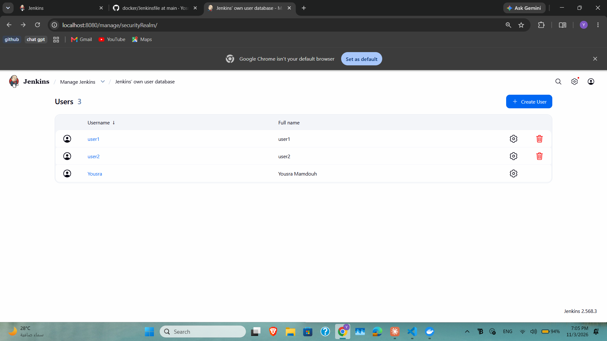
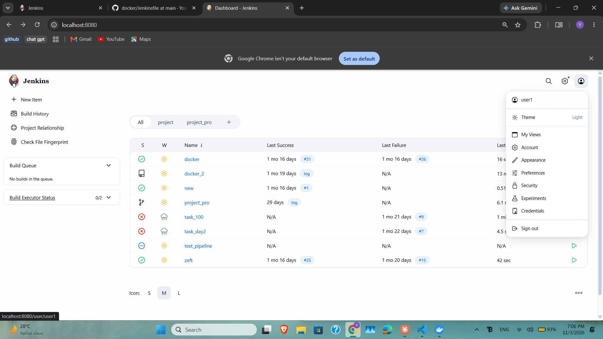
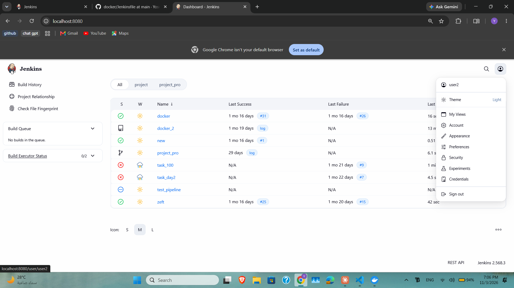

# Lab 20: Role-based Authorization in Jenkins

Two users are created in Jenkins and given different permissions with the **Role-based Authorization Strategy** plugin: `user1` is an administrator and `user2` has read-only access.

## Environment

| Item | Value |
|------|-------|
| Jenkins | 2.568.3 (LTS), running in a Docker container from the `jenkins/jenkins:lts` image |
| Address | `http://localhost:8080` |
| User database | Jenkins' own user database |
| Plugin | Role-based Authorization Strategy (`role-strategy`, with its dependency `auth-commons`) |

## Step 1: Install the plugin

`Manage Jenkins`, `Plugins`, `Available plugins`, search for **Role-based Authorization Strategy**, install it and restart Jenkins.

The Jenkins log confirms the installation:

```
Installation successful: auth-commons
Installation successful: role-strategy
Completed installation of 2 plugins in 4.3 sec
```

> After the restart the Docker container did not start again by itself, so the page stopped answering. It was started again from the terminal with `docker start <container name>`. The existing container was started, not a new one, so the jobs and the settings were kept.

## Step 2: Create the users

`Manage Jenkins`, `Users`, `Create User`. Two users were created: `user1` and `user2`, each with its own password.

> Until the users exist, the Assign Roles page shows their names with a strikethrough, because Jenkins cannot find them. The Role-based plugin only links existing users to roles; it does not create users.

## Step 3: Enable the Role-Based Strategy

`Manage Jenkins`, `Security`, `Authorization`, **Role-Based Strategy**, `Save`.

## Step 4: Define the roles

`Manage Jenkins`, `Manage and Assign Roles`, `Manage Roles`, **Global roles**:

| Role | Permissions |
|------|-------------|
| `admin` | **Administer** (includes all other permissions) |
| `readonly` | **Overall/Read**, **Job/Read**, **View/Read** only |

## Step 5: Assign the roles

`Manage and Assign Roles`, `Assign Roles`, **Add User or Group** (type **User**):

| User | Role |
|------|------|
| `Yousra Mamdouh` (the original administrator account) | `admin` |
| `user1` | `admin` |
| `user2` | `readonly` |

The original administrator account is assigned the `admin` role as well, so it is not locked out when the authorization strategy changes.

## Step 6: Test

The test was done in a separate browser window (a private window) so that the administrator session stayed open in the normal window. The name shown at the top right of the page is the user who is logged in.

| | `user1` (admin) | `user2` (readonly) |
|---|:---:|:---:|
| Sees the jobs | yes | yes (read only) |
| **New Item** | has the permission | not shown |
| **Manage Jenkins** | has the permission | not shown |
| **Build Now** | has the permission | not shown |

`user2` can see the existing jobs, because the role has **Job/Read**, but cannot create, change or build anything.

## How it works

- **Global roles** apply to the whole Jenkins. The plugin also supports **Item roles** (permissions for jobs whose names match a pattern) and **Agent roles**.
- A user gets the sum of the permissions of all the roles assigned to them. A role that has no permission for an action means the user is not allowed to do it.
- **Administer** is the permission that includes every other permission.
- Two users can have the same e-mail address. The e-mail is only contact information; the login is the user name and the password.

## Screenshots

### 1. Created Jenkins Users



### 2. User 1



### 3. User 2



### 4. Role Assignments


### 5. User 2 Access


