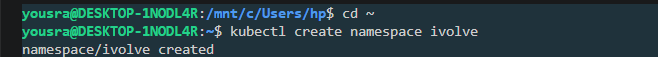
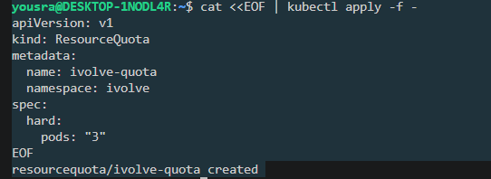
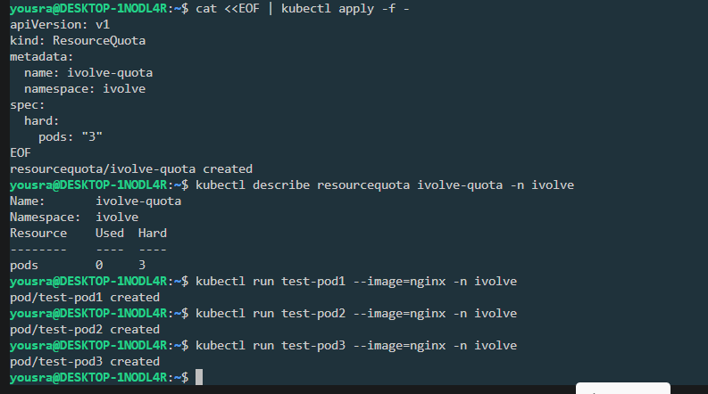
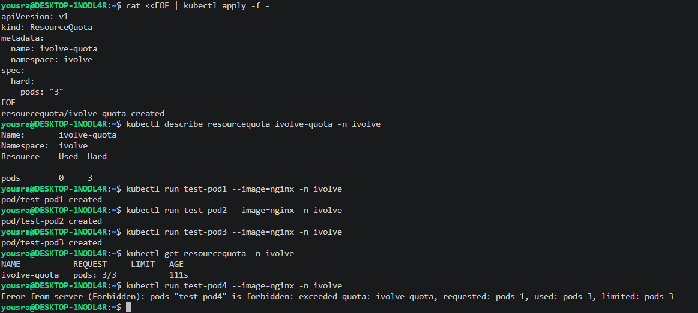

# Lab 11: Namespace and ResourceQuota

A namespace named `ivolve` with a `ResourceQuota` that limits the number of Pods in it to 3.

## Files

| File | Description |
|------|-------------|
| [`ivolve-quota.yaml`](./ivolve-quota.yaml) | ResourceQuota `ivolve-quota` (`pods: 3`) in the `ivolve` namespace |

## Step 1: Create the namespace

```bash
kubectl create namespace ivolve
```

```
namespace/ivolve created
```

## Step 2: Create the ResourceQuota

```yaml
apiVersion: v1
kind: ResourceQuota
metadata:
  name: ivolve-quota
  namespace: ivolve
spec:
  hard:
    pods: "3"
```

```bash
kubectl apply -f ivolve-quota.yaml
```

> The name must be lowercase. The first attempt with the name `ivolveQuota` was rejected by Kubernetes (`a lowercase RFC 1123 subdomain must consist of lower case alphanumeric characters, '-' or '.'`), so the quota is named `ivolve-quota`.

```
resourcequota/ivolve-quota created
```

## Step 3: Verify the quota

```bash
kubectl describe resourcequota ivolve-quota -n ivolve
```

```
Name:       ivolve-quota
Namespace:  ivolve
Resource    Used  Hard
--------    ----  ----
pods        0     3
```

## Step 4: Test the quota

Three Pods are created, which is the limit:

```bash
kubectl run test-pod1 --image=nginx -n ivolve
kubectl run test-pod2 --image=nginx -n ivolve
kubectl run test-pod3 --image=nginx -n ivolve
kubectl get resourcequota -n ivolve
```

```
NAME           REQUEST     LIMIT   AGE
ivolve-quota   pods: 3/3           111s
```

A fourth Pod is rejected:

```bash
kubectl run test-pod4 --image=nginx -n ivolve
```

```
Error from server (Forbidden): pods "test-pod4" is forbidden: exceeded quota: ivolve-quota, requested: pods=1, used: pods=3, limited: pods=3
```

The quota is enforced when the API server receives the request, so the fourth Pod is not created at all.

## Cleanup

```bash
kubectl delete pod test-pod1 test-pod2 test-pod3 -n ivolve
```

## Screenshots









