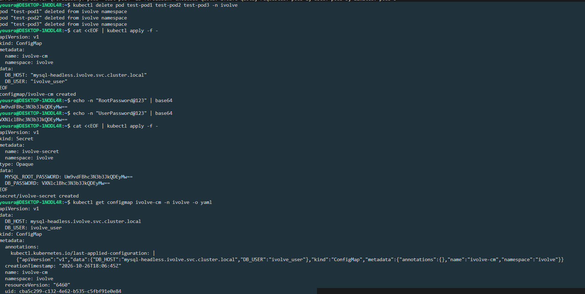
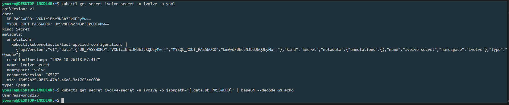

# Lab 12: ConfigMap and Secret

Application configuration is stored in a `ConfigMap` (non-sensitive values) and a `Secret` (passwords) in the `ivolve` namespace.

## Files

| File | Description |
|------|-------------|
| [`ivolve-cm.yaml`](./ivolve-cm.yaml) | ConfigMap `ivolve-cm` with `DB_HOST` and `DB_USER` |
| [`ivolve-secret.yaml`](./ivolve-secret.yaml) | Secret `ivolve-secret` with `MYSQL_ROOT_PASSWORD` and `DB_PASSWORD` |

The namespace `ivolve` was created in [Lab 11](../Lab11).

## Step 1: Create the ConfigMap

```yaml
apiVersion: v1
kind: ConfigMap
metadata:
  name: ivolve-cm
  namespace: ivolve
data:
  DB_HOST: "mysql-headless.ivolve.svc.cluster.local"
  DB_USER: "ivolve_user"
```

```bash
kubectl apply -f ivolve-cm.yaml
```

```
configmap/ivolve-cm created
```

`DB_HOST` is the DNS name of a headless Service called `mysql-headless` in the `ivolve` namespace.

## Step 2: Encode the passwords and create the Secret

Secret values must be base64 encoded. `echo -n` is used so no newline is added to the value:

```bash
echo -n "RootPassword@123" | base64     # Um9vdFBhc3N3b3JkQDEyMw==
echo -n "UserPassword@123" | base64     # VXNlclBhc3N3b3JkQDEyMw==
```

```yaml
apiVersion: v1
kind: Secret
metadata:
  name: ivolve-secret
  namespace: ivolve
type: Opaque
data:
  MYSQL_ROOT_PASSWORD: Um9vdFBhc3N3b3JkQDEyMw==
  DB_PASSWORD: VXNlclBhc3N3b3JkQDEyMw==
```

```bash
kubectl apply -f ivolve-secret.yaml
```

```
secret/ivolve-secret created
```

## Step 3: Verify

```bash
kubectl get configmap ivolve-cm -n ivolve -o yaml
kubectl get secret ivolve-secret -n ivolve -o yaml
```

The ConfigMap shows the values as plain text:

```yaml
data:
  DB_HOST: mysql-headless.ivolve.svc.cluster.local
  DB_USER: ivolve_user
```

The Secret shows the values encoded:

```yaml
data:
  DB_PASSWORD: VXNlclBhc3N3b3JkQDEyMw==
  MYSQL_ROOT_PASSWORD: Um9vdFBhc3N3b3JkQDEyMw==
```

Decode a value to check it:

```bash
kubectl get secret ivolve-secret -n ivolve -o jsonpath="{.data.DB_PASSWORD}" | base64 --decode && echo
```

```
UserPassword@123
```

## ConfigMap vs Secret

| | ConfigMap | Secret |
|---|-----------|--------|
| Used for | Non-sensitive settings | Passwords, tokens, keys |
| Stored as | Plain text | base64 encoded |
| Example here | `DB_HOST`, `DB_USER` | `MYSQL_ROOT_PASSWORD`, `DB_PASSWORD` |

> base64 is an encoding, not encryption: anyone who can read the Secret can decode it, as shown above. The passwords in this lab are only example values. In a real project, access to Secrets is restricted with RBAC, encryption at rest is enabled, and Secret manifests with real values are not committed to Git.

## Screenshots





