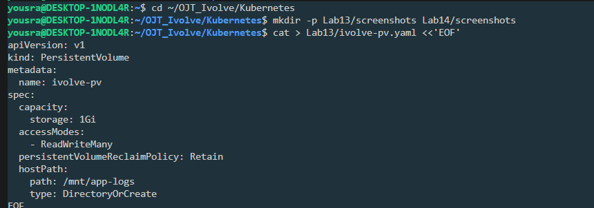
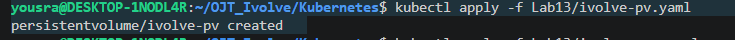
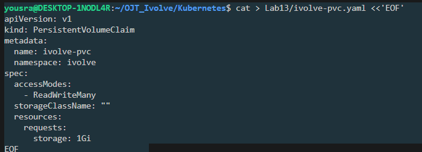
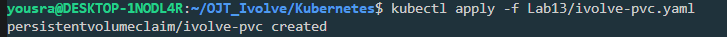
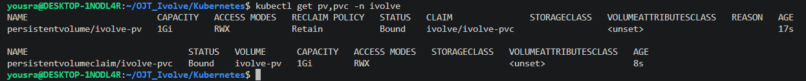

# Lab 13: Persistent Storage Setup for Application Logging

A PersistentVolume (PV) that stores data on the node file system with `hostPath`, and a PersistentVolumeClaim (PVC) that requests it. No StorageClass is used.

| Setting | PV | PVC |
|---------|----|-----|
| Name | `ivolve-pv` | `ivolve-pvc` |
| Size | 1Gi | 1Gi |
| Access mode | ReadWriteMany | ReadWriteMany |
| Storage type | `hostPath`: `/mnt/app-logs` | StorageClass set to `""` |
| Reclaim policy | Retain | |

> **Names:** the task names the objects `ivolvePV` and `ivolvePVC`. Kubernetes object names must be lowercase, so they are created as `ivolve-pv` and `ivolve-pvc`.

## Files

| File | Description |
|------|-------------|
| [`ivolve-pv.yaml`](./ivolve-pv.yaml) | The PersistentVolume |
| [`ivolve-pvc.yaml`](./ivolve-pvc.yaml) | The PersistentVolumeClaim (in the `ivolve` namespace) |
| [`log-test.yaml`](./log-test.yaml) | A test Pod that writes a log file to the volume |

## Step 1: Create the PersistentVolume

```yaml
apiVersion: v1
kind: PersistentVolume
metadata:
  name: ivolve-pv
spec:
  capacity:
    storage: 1Gi
  accessModes:
    - ReadWriteMany
  persistentVolumeReclaimPolicy: Retain
  hostPath:
    path: /mnt/app-logs
    type: DirectoryOrCreate
```

- `hostPath` stores the data in `/mnt/app-logs` on the node file system. `DirectoryOrCreate` creates the directory if it does not exist.
- `ReadWriteMany` lets several Pods read and write the volume at the same time.
- `Retain` keeps the PV and its data when the PVC is deleted, instead of deleting them.
- A PV is not namespaced.

```bash
kubectl apply -f ivolve-pv.yaml
```

```
persistentvolume/ivolve-pv created
```

## Step 2: Create the PersistentVolumeClaim

```yaml
apiVersion: v1
kind: PersistentVolumeClaim
metadata:
  name: ivolve-pvc
  namespace: ivolve
spec:
  accessModes:
    - ReadWriteMany
  storageClassName: ""
  resources:
    requests:
      storage: 1Gi
```

- The PVC requests 1Gi with the same access mode as the PV, so Kubernetes can bind them.
- `storageClassName: ""` means no StorageClass is used, so the claim binds to an existing PV instead of a dynamically provisioned one.
- The task does not name a namespace for the PVC, so it is created in `ivolve`.

```bash
kubectl apply -f ivolve-pvc.yaml
```

```
persistentvolumeclaim/ivolve-pvc created
```

## Step 3: Verify the binding

```bash
kubectl get pv,pvc -n ivolve
```

```
NAME                         CAPACITY   ACCESS MODES   RECLAIM POLICY   STATUS   CLAIM               STORAGECLASS   VOLUMEATTRIBUTESCLASS   REASON   AGE
persistentvolume/ivolve-pv   1Gi        RWX            Retain           Bound    ivolve/ivolve-pvc                  <unset>                          17s

NAME                               STATUS   VOLUME      CAPACITY   ACCESS MODES   STORAGECLASS   VOLUMEATTRIBUTESCLASS   AGE
persistentvolumeclaim/ivolve-pvc   Bound    ivolve-pv   1Gi        RWX                           <unset>                 8s
```

Both are `Bound`, and the `STORAGECLASS` column is empty, so no StorageClass is used.

## Step 4: Test the storage

A Pod mounts the PVC at `/logs` and writes a line to `/logs/app.log`. This cluster's node has the taint `workload=ivolveApp:NoSchedule` (from Lab 10), so the Pod needs a matching toleration.

```yaml
apiVersion: v1
kind: Pod
metadata:
  name: log-test
  namespace: ivolve
spec:
  tolerations:
    - key: workload
      operator: Equal
      value: ivolveApp
      effect: NoSchedule
  containers:
    - name: busybox
      image: busybox:1.36
      command: ["sh", "-c", "echo 'hello from pod' >> /logs/app.log; sleep 3600"]
      volumeMounts:
        - name: logs
          mountPath: /logs
  volumes:
    - name: logs
      persistentVolumeClaim:
        claimName: ivolve-pvc
```

```bash
kubectl apply -f log-test.yaml
kubectl wait --for=condition=Ready pod/log-test -n ivolve --timeout=90s
kubectl exec log-test -n ivolve -- cat /logs/app.log
sudo cat /mnt/app-logs/app.log
```

```
hello from pod
hello from pod
```

The first line is read from inside the Pod, and the second one directly on the node at `/mnt/app-logs/app.log`, which shows that the data is stored on the node file system.

## Cleanup

```bash
kubectl delete pod log-test -n ivolve
```

The PV and the PVC are kept.

## Screenshots













