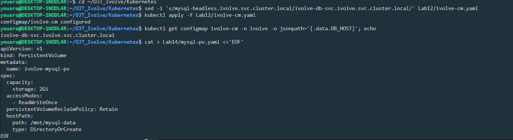
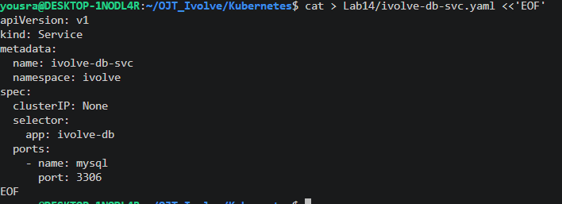
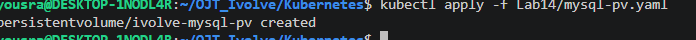
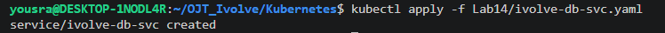
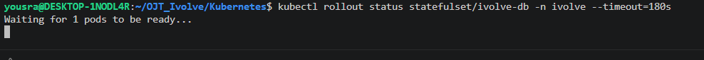
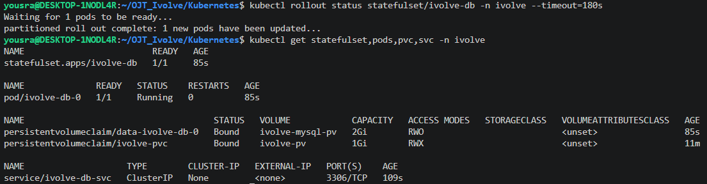
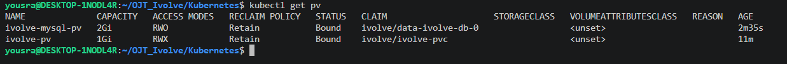

# Lab 14: StatefulSet with Headless Service

A MySQL database runs as a StatefulSet with one replica in the `ivolve` namespace. It reads its settings from the ConfigMap and the Secret of [Lab 12](../Lab12), runs only on the labeled node of [Lab 10](../Lab10), keeps its data on a PersistentVolume, and is reachable through a headless Service.

> **Names:** the task names the objects `ivolveDB` and `ivolveDBSvc`. Kubernetes object names must be lowercase, so they are created as `ivolve-db` and `ivolve-db-svc`.

## Files

| File | Description |
|------|-------------|
| [`mysql-pv.yaml`](./mysql-pv.yaml) | PersistentVolume `ivolve-mysql-pv` (2Gi, `hostPath: /mnt/mysql-data`) for the database |
| [`ivolve-db-svc.yaml`](./ivolve-db-svc.yaml) | Headless Service `ivolve-db-svc` |
| [`ivolve-db-statefulset.yaml`](./ivolve-db-statefulset.yaml) | StatefulSet `ivolve-db` |
| [`dns-test.yaml`](./dns-test.yaml) | Test Pod used to check DNS resolution |

## Step 1: Update `DB_HOST` in the ConfigMap

In Lab 12 `DB_HOST` was a placeholder. The headless Service of this lab is called `ivolve-db-svc`, so `DB_HOST` points to it:

```bash
sed -i 's/mysql-headless.ivolve.svc.cluster.local/ivolve-db-svc.ivolve.svc.cluster.local/' ../Lab12/ivolve-cm.yaml
kubectl apply -f ../Lab12/ivolve-cm.yaml
kubectl get configmap ivolve-cm -n ivolve -o jsonpath='{.data.DB_HOST}'; echo
```

```
configmap/ivolve-cm configured
ivolve-db-svc.ivolve.svc.cluster.local
```

## Step 2: PersistentVolume for MySQL

The cluster has no StorageClass, so a claim cannot get a volume created automatically. A PersistentVolume is created for the database, and the claim of the StatefulSet binds to it. (The PV of Lab 13 is `ReadWriteMany` and already bound to its own claim.)

```yaml
apiVersion: v1
kind: PersistentVolume
metadata:
  name: ivolve-mysql-pv
spec:
  capacity:
    storage: 2Gi
  accessModes:
    - ReadWriteOnce
  persistentVolumeReclaimPolicy: Retain
  hostPath:
    path: /mnt/mysql-data
    type: DirectoryOrCreate
```

```bash
kubectl apply -f mysql-pv.yaml
```

```
persistentvolume/ivolve-mysql-pv created
```

## Step 3: Headless Service

```yaml
apiVersion: v1
kind: Service
metadata:
  name: ivolve-db-svc
  namespace: ivolve
spec:
  clusterIP: None
  selector:
    app: ivolve-db
  ports:
    - name: mysql
      port: 3306
```

`clusterIP: None` makes the Service headless: it has no virtual IP, and DNS returns the IP address of the Pod directly. The StatefulSet uses it (`serviceName`) to give each Pod a stable DNS name.

```bash
kubectl apply -f ivolve-db-svc.yaml
```

```
service/ivolve-db-svc created
```

## Step 4: StatefulSet

```yaml
apiVersion: apps/v1
kind: StatefulSet
metadata:
  name: ivolve-db
  namespace: ivolve
spec:
  serviceName: ivolve-db-svc
  replicas: 1
  selector:
    matchLabels:
      app: ivolve-db
  template:
    metadata:
      labels:
        app: ivolve-db
    spec:
      nodeSelector:
        project: ivolve
      tolerations:
        - key: workload
          operator: Equal
          value: ivolveApp
          effect: NoSchedule
      containers:
        - name: mysql
          image: mysql:8.0
          ports:
            - name: mysql
              containerPort: 3306
          envFrom:
            - configMapRef:
                name: ivolve-cm
            - secretRef:
                name: ivolve-secret
          env:
            - name: MYSQL_DATABASE
              value: ivolve
            - name: MYSQL_USER
              valueFrom:
                configMapKeyRef:
                  name: ivolve-cm
                  key: DB_USER
            - name: MYSQL_PASSWORD
              valueFrom:
                secretKeyRef:
                  name: ivolve-secret
                  key: DB_PASSWORD
          volumeMounts:
            - name: data
              mountPath: /var/lib/mysql
  volumeClaimTemplates:
    - metadata:
        name: data
      spec:
        accessModes: ["ReadWriteOnce"]
        storageClassName: ""
        resources:
          requests:
            storage: 1Gi
```

| Requirement | How it is done |
|-------------|----------------|
| 1 replica running MySQL | `replicas: 1`, image `mysql:8.0` |
| Variables from the ConfigMap and the Secret | `envFrom` with `ivolve-cm` and `ivolve-secret` |
| Variables the MySQL image understands | `env` maps `DB_USER` to `MYSQL_USER` and `DB_PASSWORD` to `MYSQL_PASSWORD`; `MYSQL_ROOT_PASSWORD` comes from the Secret directly; `MYSQL_DATABASE` is `ivolve` |
| Run on the node labeled `project=ivolve` | `nodeSelector: project: ivolve` |
| Tolerate the taint | toleration for `workload=ivolveApp` with effect `NoSchedule` |
| PVC template mounted at `/var/lib/mysql` | `volumeClaimTemplates` named `data`, mounted at `/var/lib/mysql`; no StorageClass |

```bash
kubectl apply -f ivolve-db-statefulset.yaml
kubectl rollout status statefulset/ivolve-db -n ivolve --timeout=180s
```

```
statefulset.apps/ivolve-db created
Waiting for 1 pods to be ready...
partitioned roll out complete: 1 new pods have been updated...
```

## Step 5: Verify the resources

```bash
kubectl get statefulset,pods,pvc,svc -n ivolve
kubectl get pv
```

```
NAME                         READY   AGE
statefulset.apps/ivolve-db   1/1     85s

NAME              READY   STATUS    RESTARTS   AGE
pod/ivolve-db-0   1/1     Running   0          85s

NAME                                     STATUS   VOLUME            CAPACITY   ACCESS MODES   STORAGECLASS   VOLUMEATTRIBUTESCLASS   AGE
persistentvolumeclaim/data-ivolve-db-0   Bound    ivolve-mysql-pv   2Gi        RWO                           <unset>                 85s
persistentvolumeclaim/ivolve-pvc         Bound    ivolve-pv         1Gi        RWX                           <unset>                 11m

NAME                    TYPE        CLUSTER-IP   EXTERNAL-IP   PORT(S)    AGE
service/ivolve-db-svc   ClusterIP   None         <none>        3306/TCP   109s
```

```
NAME              CAPACITY   ACCESS MODES   RECLAIM POLICY   STATUS   CLAIM                     STORAGECLASS   VOLUMEATTRIBUTESCLASS   REASON   AGE
ivolve-mysql-pv   2Gi        RWO            Retain           Bound    ivolve/data-ivolve-db-0                  <unset>                          2m35s
ivolve-pv         1Gi        RWX            Retain           Bound    ivolve/ivolve-pvc                        <unset>                          11m
```

The Pod `ivolve-db-0` is `Running`, the claim `data-ivolve-db-0` created by the template is bound to `ivolve-mysql-pv`, and the Service has `CLUSTER-IP: None`.

## Step 6: Connect with a MySQL client

The `mysql` client inside the Pod uses the variables that came from the ConfigMap and the Secret:

```bash
kubectl exec -it ivolve-db-0 -n ivolve -- bash -c 'mysql -u "$DB_USER" -p"$DB_PASSWORD" -e "SHOW DATABASES;"'
kubectl exec ivolve-db-0 -n ivolve -- bash -c 'echo DB_HOST=$DB_HOST DB_USER=$DB_USER'
```

```
mysql: [Warning] Using a password on the command line interface can be insecure.
+--------------------+
| Database           |
+--------------------+
| information_schema |
| ivolve             |
| performance_schema |
+--------------------+
```

```
DB_HOST=ivolve-db-svc.ivolve.svc.cluster.local DB_USER=ivolve_user
```

The login with `DB_USER` and `DB_PASSWORD` works and the `ivolve` database exists, so the database is operational and the variables from the ConfigMap and the Secret reach the container.

## Step 7: Verify DNS resolution

A temporary Pod in the same namespace resolves the Service and the Pod name. It needs the toleration of the node taint to be scheduled.

```yaml
apiVersion: v1
kind: Pod
metadata:
  name: dns-test
  namespace: ivolve
spec:
  tolerations:
    - key: workload
      operator: Equal
      value: ivolveApp
      effect: NoSchedule
  containers:
    - name: busybox
      image: busybox:1.28
      command: ["sleep", "3600"]
```

```bash
kubectl apply -f dns-test.yaml
kubectl wait --for=condition=Ready pod/dns-test -n ivolve --timeout=90s
kubectl exec dns-test -n ivolve -- nslookup ivolve-db-svc.ivolve.svc.cluster.local
kubectl exec dns-test -n ivolve -- nslookup ivolve-db-0.ivolve-db-svc.ivolve.svc.cluster.local
```

```
Name:      ivolve-db-svc.ivolve.svc.cluster.local
Address 1: 192.168.131.17 ivolve-db-0.ivolve-db-svc.ivolve.svc.cluster.local

Name:      ivolve-db-0.ivolve-db-svc.ivolve.svc.cluster.local
Address 1: 192.168.131.17 ivolve-db-0.ivolve-db-svc.ivolve.svc.cluster.local
```

- The Service name resolves directly to the Pod IP (`192.168.131.17`), because the Service is headless.
- The stable Pod name `ivolve-db-0.ivolve-db-svc.ivolve.svc.cluster.local` resolves to the same IP, and it stays the same if the Pod is recreated.

## Cleanup

```bash
kubectl delete pod dns-test -n ivolve
```

## Screenshots
















