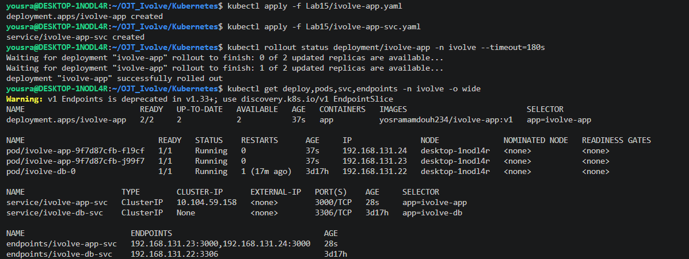
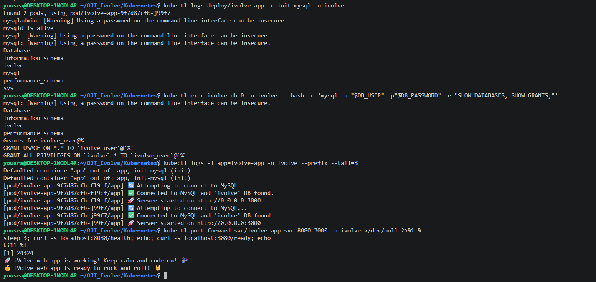
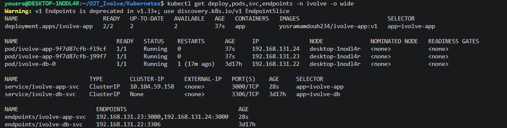

# Lab 15: Node.js Application Deployment with a ClusterIP Service

The Node.js application image from [Lab 8](../../Docker/Lab8) is deployed in the `ivolve` namespace with 2 replicas. It takes its settings from the ConfigMap and the Secret of [Lab 12](../Lab12), stores its logs on the volume of [Lab 13](../Lab13), runs on the node labeled `project=ivolve`, and connects to the MySQL StatefulSet of [Lab 14](../Lab14). A ClusterIP Service distributes the traffic between the Pods.

> **Names:** the task names the objects `ivolveApp` and `ivolvaAppSvc`. Kubernetes object names must be lowercase, so they are created as `ivolve-app` and `ivolve-app-svc`.

## Files

| File | Description |
|------|-------------|
| [`ivolve-app.yaml`](./ivolve-app.yaml) | Deployment `ivolve-app` with the init container |
| [`ivolve-app-svc.yaml`](./ivolve-app-svc.yaml) | ClusterIP Service `ivolve-app-svc` |

## Step 1: The Deployment

```yaml
apiVersion: apps/v1
kind: Deployment
metadata:
  name: ivolve-app
  namespace: ivolve
spec:
  replicas: 2
  strategy:
    type: RollingUpdate
    rollingUpdate:
      maxSurge: 0
      maxUnavailable: 1
  selector:
    matchLabels:
      app: ivolve-app
  template:
    metadata:
      labels:
        app: ivolve-app
    spec:
      nodeSelector:
        project: ivolve
      tolerations:
        - key: workload
          operator: Equal
          value: ivolveApp
          effect: NoSchedule
      initContainers:
        - name: init-mysql
          image: mysql:8.0
          envFrom:
            - configMapRef:
                name: ivolve-cm
            - secretRef:
                name: ivolve-secret
          command: ["sh", "-c"]
          args:
            - |
              until mysqladmin ping -h "$DB_HOST" -u root -p"$MYSQL_ROOT_PASSWORD" --silent; do
                echo "waiting for MySQL..."; sleep 3
              done
              mysql -h "$DB_HOST" -u root -p"$MYSQL_ROOT_PASSWORD" <<SQL
              CREATE DATABASE IF NOT EXISTS ivolve;
              CREATE USER IF NOT EXISTS '${DB_USER}'@'%' IDENTIFIED BY '${DB_PASSWORD}';
              GRANT ALL PRIVILEGES ON ivolve.* TO '${DB_USER}'@'%';
              FLUSH PRIVILEGES;
              SQL
              mysql -h "$DB_HOST" -u root -p"$MYSQL_ROOT_PASSWORD" -e "SHOW DATABASES;"
      containers:
        - name: app
          image: yosramamdouh234/ivolve-app:v1
          ports:
            - containerPort: 3000
          envFrom:
            - configMapRef:
                name: ivolve-cm
          env:
            - name: DB_NAME
              value: ivolve
            - name: DB_PASSWORD
              valueFrom:
                secretKeyRef:
                  name: ivolve-secret
                  key: DB_PASSWORD
          volumeMounts:
            - name: logs
              mountPath: /app/logs
      volumes:
        - name: logs
          persistentVolumeClaim:
            claimName: ivolve-pvc
```

| Requirement | How it is done |
|-------------|----------------|
| 2 replicas in the `ivolve` namespace | `replicas: 2`, `namespace: ivolve` |
| Image from Docker Hub (Lab 8) | `yosramamdouh234/ivolve-app:v1` |
| Variables from the ConfigMap and the Secret | `envFrom` with `ivolve-cm` (`DB_HOST`, `DB_USER`) and `DB_PASSWORD` from `ivolve-secret` |
| Node selector | `nodeSelector: project: ivolve` |
| Toleration | `workload=ivolveApp` with effect `NoSchedule` |
| Use the volume of Lab 13 | the PVC `ivolve-pvc` is mounted at `/app/logs`, where the application writes its access log |
| Init container with a MySQL client | `mysql:8.0` image; creates the `ivolve` database and the application user, and grants the privileges |
| Connection parameters in the init container | `envFrom` with the ConfigMap and the Secret |

Notes:

- The init container waits for MySQL with `mysqladmin ping`, then runs the SQL statements. They use `IF NOT EXISTS`, so running them again is safe (the database and the user were already created by the MySQL image in Lab 14).
- The init container connects as `root` to create the user and the grants, so it receives `MYSQL_ROOT_PASSWORD`. The application container only receives `DB_PASSWORD`, not the root password.
- The namespace has a ResourceQuota of 3 Pods ([Lab 11](../Lab11)): 2 application Pods and the MySQL Pod use all of it. `maxSurge: 0` makes a rolling update replace Pods without creating an extra one, which the quota would reject.

## Step 2: The ClusterIP Service

```yaml
apiVersion: v1
kind: Service
metadata:
  name: ivolve-app-svc
  namespace: ivolve
spec:
  type: ClusterIP
  selector:
    app: ivolve-app
  ports:
    - port: 3000
      targetPort: 3000
```

The Service selects the Pods with the label `app=ivolve-app` and distributes the traffic between them.

## Step 3: Deploy

```bash
kubectl apply -f ivolve-app.yaml
kubectl apply -f ivolve-app-svc.yaml
kubectl rollout status deployment/ivolve-app -n ivolve --timeout=180s
kubectl get deploy,pods,svc,endpoints -n ivolve -o wide
```

```
NAME                         READY   UP-TO-DATE   AVAILABLE   AGE   CONTAINERS   IMAGES                          SELECTOR
deployment.apps/ivolve-app   2/2     2            2           37s   app          yosramamdouh234/ivolve-app:v1   app=ivolve-app

NAME                             READY   STATUS    RESTARTS      AGE     IP               NODE              NOMINATED NODE   READINESS GATES
pod/ivolve-app-9f7d87cfb-fl9cf   1/1     Running   0             37s     192.168.131.24   desktop-1nodl4r   <none>           <none>
pod/ivolve-app-9f7d87cfb-j99f7   1/1     Running   0             37s     192.168.131.23   desktop-1nodl4r   <none>           <none>
pod/ivolve-db-0                  1/1     Running   1 (17m ago)   3d17h   192.168.131.22   desktop-1nodl4r   <none>           <none>

NAME                     TYPE        CLUSTER-IP      EXTERNAL-IP   PORT(S)    AGE     SELECTOR
service/ivolve-app-svc   ClusterIP   10.104.59.158   <none>        3000/TCP   28s     app=ivolve-app
service/ivolve-db-svc    ClusterIP   None            <none>        3306/TCP   3d17h   app=ivolve-db

NAME                       ENDPOINTS                                 AGE
endpoints/ivolve-app-svc   192.168.131.23:3000,192.168.131.24:3000   28s
endpoints/ivolve-db-svc    192.168.131.22:3306                       3d17h
```

Both application Pods are `Running`, and the Service has one endpoint for each Pod, so the traffic is distributed across them.

## Step 4: Verify the init container

```bash
kubectl logs deploy/ivolve-app -c init-mysql -n ivolve
```

```
mysqld is alive
Database
information_schema
ivolve
mysql
performance_schema
sys
```

(The `Using a password on the command line interface can be insecure` warnings of the `mysql` client are left out.) The init container reached MySQL, and the `ivolve` database is in the list.

## Step 5: Connect to MySQL manually

The `mysql` client connects as the application user to check the database and the privileges:

```bash
kubectl exec ivolve-db-0 -n ivolve -- bash -c 'mysql -u "$DB_USER" -p"$DB_PASSWORD" -e "SHOW DATABASES; SHOW GRANTS;"'
```

```
Database
information_schema
ivolve
performance_schema
Grants for ivolve_user@%
GRANT USAGE ON *.* TO `ivolve_user`@`%`
GRANT ALL PRIVILEGES ON `ivolve`.* TO `ivolve_user`@`%`
```

The `ivolve` database exists, and `ivolve_user` has `ALL PRIVILEGES` on it.

## Step 6: Check the application logs

```bash
kubectl logs -l app=ivolve-app -n ivolve --prefix --tail=8
```

```
[pod/ivolve-app-9f7d87cfb-fl9cf/app] 🔄 Attempting to connect to MySQL...
[pod/ivolve-app-9f7d87cfb-fl9cf/app] ✅ Connected to MySQL and 'ivolve' DB found.
[pod/ivolve-app-9f7d87cfb-fl9cf/app] 🚀 Server started on http://0.0.0.0:3000
[pod/ivolve-app-9f7d87cfb-j99f7/app] 🔄 Attempting to connect to MySQL...
[pod/ivolve-app-9f7d87cfb-j99f7/app] ✅ Connected to MySQL and 'ivolve' DB found.
[pod/ivolve-app-9f7d87cfb-j99f7/app] 🚀 Server started on http://0.0.0.0:3000
```

Both Pods connected to MySQL, found the `ivolve` database, and started the server.

## Step 7: Test the Service

```bash
kubectl port-forward svc/ivolve-app-svc 8080:3000 -n ivolve >/dev/null 2>&1 &
sleep 3
curl -s localhost:8080/health; echo
curl -s localhost:8080/ready; echo
kill %1
```

```
🚀 iVolve web app is working! Keep calm and code on! 🎉
👍 iVolve web app is ready to rock and roll! 🤘
```

`/health` and `/ready` run a query on the database, so these answers also confirm the connection between the application and MySQL through the Service.

## Screenshots







