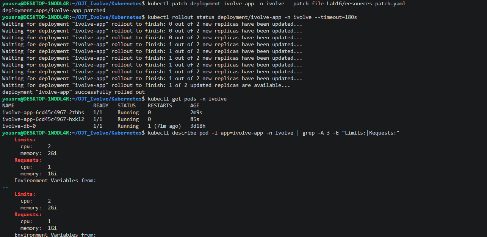
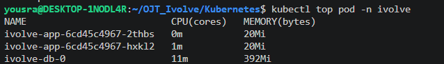
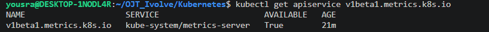
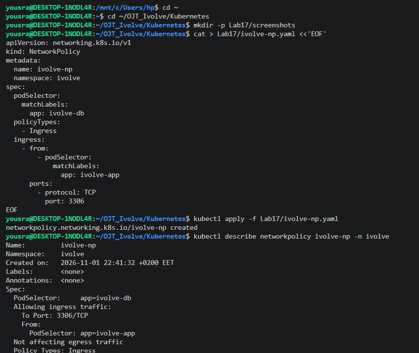

# Lab 16: Pod Resource Management with CPU and Memory Requests and Limits

The `ivolve-app` Deployment of [Lab 15](../Lab15) is updated with resource requests and limits, and the usage of the Pods is monitored with `kubectl top`.

| | CPU | Memory |
|---|-----|--------|
| **Requests** | 1 | 1Gi |
| **Limits** | 2 | 2Gi |

- A **request** is the amount the scheduler reserves for the container on a node. A Pod is scheduled only on a node that has this much unreserved.
- A **limit** is the maximum the container can use. A container that goes over its CPU limit is throttled, and a container that goes over its memory limit is killed (`OOMKilled`).

## Files

| File | Description |
|------|-------------|
| [`resources-patch.yaml`](./resources-patch.yaml) | Patch that adds the requests and limits to the `app` container |

## Step 1: Check that the node has enough resources

Each Pod requests 1 CPU and 1Gi, so the two replicas request 2 CPUs and 2Gi:

```bash
nproc; free -h | grep Mem
kubectl describe node desktop-1nodl4r | grep -A 6 "Allocated resources"
```

```
20
Mem:           7.6Gi       1.9Gi       3.1Gi       6.6Mi       2.8Gi       5.7Gi

Allocated resources:
  (Total limits may be over 100 percent, i.e., overcommitted.)
  Resource           Requests    Limits
  --------           --------    ------
  cpu                1100m (5%)  0 (0%)
  memory             240Mi (3%)  340Mi (4%)
  ephemeral-storage  0 (0%)      0 (0%)
```

The node has 20 CPUs and 7.6Gi of memory, and only a small part is reserved, so the Pods fit.

## Step 2: Update the Deployment

The existing Deployment is updated with a patch. Kubernetes matches the container by its name (`app`) and only adds the `resources` section:

```yaml
spec:
  template:
    spec:
      containers:
        - name: app
          resources:
            requests:
              cpu: "1"
              memory: 1Gi
            limits:
              cpu: "2"
              memory: 2Gi
```

```bash
kubectl patch deployment ivolve-app -n ivolve --patch-file resources-patch.yaml
kubectl rollout status deployment/ivolve-app -n ivolve --timeout=180s
kubectl get pods -n ivolve
```

```
deployment.apps/ivolve-app patched
...
deployment "ivolve-app" successfully rolled out

NAME                          READY   STATUS    RESTARTS      AGE
ivolve-app-6cd45c4967-2thbs   1/1     Running   0             2m9s
ivolve-app-6cd45c4967-hxkl2   1/1     Running   0             85s
ivolve-db-0                   1/1     Running   1 (71m ago)   3d18h
```

The patch changes the Pod template, so Kubernetes replaces the Pods with new ones. The Deployment has `maxSurge: 0`, so the old Pods are replaced one at a time without creating an extra Pod, and the namespace quota of 3 Pods is never exceeded.

## Step 3: Verify the requests and limits

```bash
kubectl describe pod -l app=ivolve-app -n ivolve | grep -A 3 -E "Limits:|Requests:"
```

```
    Limits:
      cpu:     2
      memory:  2Gi
    Requests:
      cpu:     1
      memory:  1Gi
```

The output is the same for both Pods (it is shown once here). The requests are 1 CPU and 1Gi, and the limits are 2 CPUs and 2Gi.

## Step 4: Monitor the usage with `kubectl top`

`kubectl top` needs the metrics server, which was not installed in the cluster. It is installed from the official manifest:

```bash
kubectl apply -f https://github.com/kubernetes-sigs/metrics-server/releases/latest/download/components.yaml
```

Two changes are needed for this cluster:

- `--kubelet-insecure-tls`: the metrics server connects to the kubelet, whose certificate in a kubeadm cluster is not signed by a CA that the metrics server trusts.
- A toleration for `workload=ivolveApp:NoSchedule`: the node has this taint (Lab 10), and without the toleration the metrics server Pod stays `Pending` with the event `untolerated taint(s)`.

```bash
kubectl patch deployment metrics-server -n kube-system --type='json' -p='[
 {"op":"add","path":"/spec/template/spec/containers/0/args/-","value":"--kubelet-insecure-tls"},
 {"op":"add","path":"/spec/template/spec/tolerations","value":[{"key":"workload","operator":"Equal","value":"ivolveApp","effect":"NoSchedule"}]}
]'
```

```bash
kubectl get pods -n kube-system | grep metrics
kubectl get apiservice v1beta1.metrics.k8s.io
kubectl top nodes
kubectl top pod -n ivolve
```

```
metrics-server-c697bf595-m4ttf             1/1     Running   0              5m49s

NAME                     SERVICE                      AVAILABLE   AGE
v1beta1.metrics.k8s.io   kube-system/metrics-server   True        21m

NAME              CPU(cores)   CPU(%)   MEMORY(bytes)   MEMORY(%)
desktop-1nodl4r   399m         1%       2149Mi          27%

NAME                          CPU(cores)   MEMORY(bytes)
ivolve-app-6cd45c4967-2thbs   0m           20Mi
ivolve-app-6cd45c4967-hxkl2   1m           20Mi
ivolve-db-0                   11m          392Mi
```

The metrics server is `Running`, and the metrics API is available (`AVAILABLE: True`).

Each application Pod uses about 20Mi of memory and almost no CPU, far below its request (1 CPU and 1Gi) and its limit (2 CPUs and 2Gi). The request is a reservation made for the scheduler, not the real usage, so `kubectl top` shows the actual consumption, and the two values should be compared when sizing a workload.

## Screenshots









