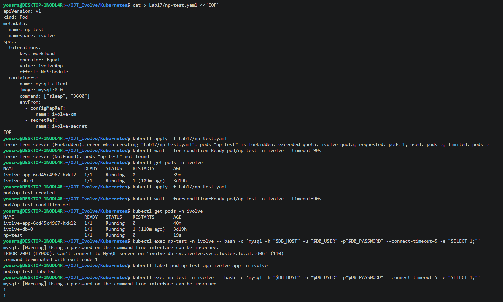
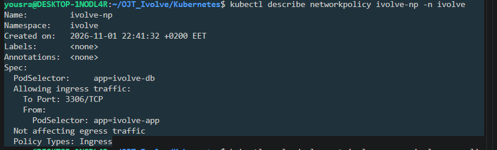
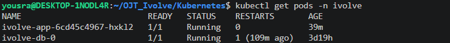
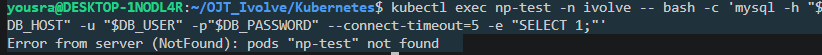
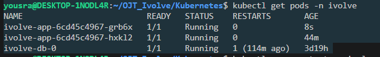
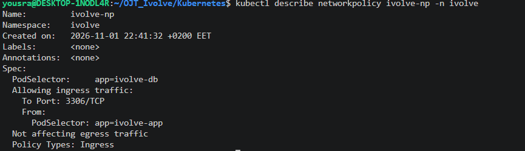

# Lab 17: Control Pod-to-Pod Traffic via Network Policy

A NetworkPolicy protects the MySQL Pod of [Lab 14](../Lab14): only the application Pods of [Lab 15](../Lab15) can connect to it, and only on port 3306.

> **Name:** the task names the policy `ivolveNP`. Kubernetes object names must be lowercase, so it is created as `ivolve-np`.

## Files

| File | Description |
|------|-------------|
| [`ivolve-np.yaml`](./ivolve-np.yaml) | The NetworkPolicy `ivolve-np` |
| [`np-test.yaml`](./np-test.yaml) | A test Pod with a MySQL client, used to check the policy |

## Step 1: Create the NetworkPolicy

```yaml
apiVersion: networking.k8s.io/v1
kind: NetworkPolicy
metadata:
  name: ivolve-np
  namespace: ivolve
spec:
  podSelector:
    matchLabels:
      app: ivolve-db
  policyTypes:
    - Ingress
  ingress:
    - from:
        - podSelector:
            matchLabels:
              app: ivolve-app
      ports:
        - protocol: TCP
          port: 3306
```

| Requirement | How it is done |
|-------------|----------------|
| Target the MySQL Pod | `podSelector` with the label `app=ivolve-db` (the label of the StatefulSet Pod) |
| Only Ingress | `policyTypes: [Ingress]` |
| Allow traffic only from the application Pods | `from` with `podSelector` `app=ivolve-app` (the label of the Deployment Pods) |
| Restrict to port 3306 | `ports` with TCP `3306` |

Once a Pod is selected by a policy for Ingress, all incoming traffic to it is denied except what the rules allow. The policy has no `Egress` type, so the outgoing traffic of the MySQL Pod is not affected.

```bash
kubectl apply -f ivolve-np.yaml
kubectl describe networkpolicy ivolve-np -n ivolve
```

```
Name:         ivolve-np
Namespace:    ivolve
Created on:   2026-11-01 22:41:32 +0200 EET
Labels:       <none>
Annotations:  <none>
Spec:
  PodSelector:     app=ivolve-db
  Allowing ingress traffic:
    To Port: 3306/TCP
    From:
      PodSelector: app=ivolve-app
  Not affecting egress traffic
  Policy Types: Ingress
```

The policy selects the MySQL Pod (`app=ivolve-db`), allows ingress only from the Pods with the label `app=ivolve-app` on port `3306/TCP`, and does not affect egress traffic.

## Step 2: Prepare the test Pod

The namespace has a ResourceQuota of 3 Pods ([Lab 11](../Lab11)), and the MySQL Pod and the 2 application Pods use all of it. The application is scaled down to 1 replica to leave room for a test Pod:

```bash
kubectl scale deployment ivolve-app -n ivolve --replicas=1
kubectl apply -f np-test.yaml
kubectl wait --for=condition=Ready pod/np-test -n ivolve --timeout=90s
kubectl get pods -n ivolve
```

```
NAME                          READY   STATUS    RESTARTS       AGE
ivolve-app-6cd45c4967-hxkl2   1/1     Running   0              40m
ivolve-db-0                   1/1     Running   1 (110m ago)   3d19h
np-test                       1/1     Running   0              19s
```

> The first `kubectl apply` of the test Pod was rejected with `exceeded quota: ivolve-quota ... used: pods=3, limited: pods=3`, because the second application Pod was still terminating and counted in the quota. It worked a few seconds later, after the Pod was gone.

The test Pod uses the `mysql:8.0` image (it contains the MySQL client), takes the connection settings from the ConfigMap and the Secret, and has the toleration for the node taint. It has no `app=ivolve-app` label at first.

## Step 3: Test without the application label (blocked)

```bash
kubectl exec np-test -n ivolve -- bash -c 'mysql -h "$DB_HOST" -u "$DB_USER" -p"$DB_PASSWORD" --connect-timeout=5 -e "SELECT 1;"'
```

```
ERROR 2003 (HY000): Can't connect to MySQL server on 'ivolve-db-svc.ivolve.svc.cluster.local:3306' (110)
command terminated with exit code 1
```

The connection times out (error 110 is a connection timeout), because the Pod does not match the policy and its packets are dropped.

## Step 4: Test with the application label (allowed)

The label of the application Pods is added to the test Pod. The policy checks the label, so the Pod is now allowed:

```bash
kubectl label pod np-test app=ivolve-app -n ivolve
kubectl exec np-test -n ivolve -- bash -c 'mysql -h "$DB_HOST" -u "$DB_USER" -p"$DB_PASSWORD" --connect-timeout=5 -e "SELECT 1;"'
```

```
pod/np-test labeled
1
1
```

The query returns `1`: the same Pod, with the same credentials, can now connect to MySQL on port 3306.

| Test Pod | Label `app=ivolve-app` | Result |
|----------|:----------------------:|--------|
| `np-test` | no | Connection blocked (timeout) |
| `np-test` | yes | Connection allowed (`SELECT 1` returns `1`) |

## Cleanup

```bash
kubectl delete pod np-test -n ivolve
kubectl scale deployment ivolve-app -n ivolve --replicas=2
kubectl get pods -n ivolve
```

```
NAME                          READY   STATUS    RESTARTS       AGE
ivolve-app-6cd45c4967-grb6x   1/1     Running   0              8s
ivolve-app-6cd45c4967-hxkl2   1/1     Running   0              44m
ivolve-db-0                   1/1     Running   1 (114m ago)   3d19h
```

The test Pod is deleted and the application is back to 2 replicas.

## Screenshots













