# Lab 18: Monitoring with Prometheus, Alertmanager, Grafana and a node-exporter DaemonSet

A monitoring stack in the `monitoring` namespace. A **DaemonSet** runs Prometheus `node-exporter` on every node, **Prometheus** collects the metrics, **Alertmanager** sends an e-mail when CPU or memory usage goes above 80%, and **Grafana** shows a dashboard with CPU and memory.

## Files

| File | Description |
|------|-------------|
| [`00-namespace.yaml`](./00-namespace.yaml) | Namespace `monitoring` |
| [`node-exporter.yaml`](./node-exporter.yaml) | DaemonSet `node-exporter` (port 9100, `hostNetwork`) |
| [`prometheus.yaml`](./prometheus.yaml) | ServiceAccount, Role, RoleBinding, scrape config, alert rules, Deployment and Service |
| [`alertmanager.yaml`](./alertmanager.yaml) | Alertmanager Deployment and Service |
| [`alertmanager-config.template.yml`](./alertmanager-config.template.yml) | Alertmanager config **template** (placeholders only) |
| [`grafana.yaml`](./grafana.yaml) | Grafana data source, dashboard provisioning, dashboard JSON, Deployment and Service |
| [`stress-cpu.yaml`](./stress-cpu.yaml) | Test Pod that loads every CPU core |
| [`stress-memory.yaml`](./stress-memory.yaml) | Test Pod that allocates memory |

## Environment

One node (`desktop-1nodl4r`, 20 CPU cores, about 7.8 GB RAM). The node has the taint `workload=ivolveApp:NoSchedule` from Lab 10, so every Pod in this lab has `tolerations: - operator: Exists`; without it the Pods stay `Pending`.

## How it works

| Component | Role |
|-----------|------|
| node-exporter (DaemonSet) | Exposes node metrics at `<node_IP>:9100/metrics`. A DaemonSet runs one Pod on every node. |
| Prometheus | Scrapes every node-exporter Pod every 15 seconds and evaluates the alert rules |
| Alertmanager | Receives alerts from Prometheus and sends the e-mail |
| Grafana | Shows the dashboard, reading from Prometheus |

Prometheus finds the node-exporter Pods with Kubernetes service discovery (`role: pod`, label `app=node-exporter`), so a new node is scraped automatically. This needs the Role that allows `get`, `list` and `watch` on Pods in the `monitoring` namespace.

## Step 1: Create the namespace

```bash
kubectl apply -f 00-namespace.yaml
kubectl get ns monitoring
```

```
namespace/monitoring created
NAME         STATUS   AGE
monitoring   Active   9s
```

## Step 2: Deploy node-exporter as a DaemonSet

`hostNetwork: true` makes the Pod use the node's IP, so the metrics are reachable on `<node_IP>:9100`.

```bash
kubectl apply -f node-exporter.yaml
kubectl get ds -n monitoring
kubectl get pods -n monitoring -o wide
```

```
NAME                  READY   STATUS    RESTARTS   AGE   IP              NODE
node-exporter-5mtf9   1/1     Running   0          13s   172.30.194.27   desktop-1nodl4r
```

One Pod exists because the cluster has one node: a DaemonSet creates one Pod per node.

### Check the metrics on `<node_IP>:9100`

```bash
NODE_IP=$(kubectl get nodes -o jsonpath='{.items[0].status.addresses[?(@.type=="InternalIP")].address}')
echo $NODE_IP
curl -s http://$NODE_IP:9100/metrics | head -15
curl -s http://$NODE_IP:9100/metrics | grep -c node_cpu_seconds_total
```

```
172.30.194.27
# HELP go_gc_duration_seconds A summary of the pause duration of garbage collection cycles.
# TYPE go_gc_duration_seconds summary
go_gc_duration_seconds{quantile="0"} 0
...
162
```

## Step 3: Deploy Prometheus

```bash
kubectl apply -f prometheus.yaml
kubectl rollout status deployment/prometheus -n monitoring --timeout=120s
```

```
serviceaccount/prometheus created
role.rbac.authorization.k8s.io/prometheus created
rolebinding.rbac.authorization.k8s.io/prometheus created
configmap/prometheus-config created
configmap/prometheus-rules created
deployment.apps/prometheus created
service/prometheus created
deployment "prometheus" successfully rolled out
```

The scrape job in `prometheus-config`:

```yaml
- job_name: node-exporter
  kubernetes_sd_configs:
    - role: pod
      namespaces:
        names: [monitoring]
  relabel_configs:
    - source_labels: [__meta_kubernetes_pod_label_app]
      regex: node-exporter
      action: keep
    - source_labels: [__meta_kubernetes_pod_node_name]
      target_label: node
```

The alert rules in `prometheus-rules` fire when usage is above 80% for 1 minute:

```yaml
- alert: HighCPUUsage
  expr: 100 - (avg by (instance) (rate(node_cpu_seconds_total{mode="idle"}[1m])) * 100) > 80
  for: 1m
- alert: HighMemoryUsage
  expr: (1 - node_memory_MemAvailable_bytes / node_memory_MemTotal_bytes) * 100 > 80
  for: 1m
```

## Step 4: Deploy Alertmanager with e-mail notifications

Gmail SMTP needs an **App Password** (Google Account, Security, 2-Step Verification, App passwords); the normal password does not work.

The real address and App Password are **not stored in this repository**. The config is generated from the template, loaded into a Secret, and the local file is deleted:

```bash
read -p "Your Gmail address: " MAIL
read -sp "App password: " APPPASS; echo
APPPASS=${APPPASS// /}
sed -e "s/MAIL_ADDRESS/$MAIL/g" -e "s/APP_PASSWORD/$APPPASS/" alertmanager-config.template.yml > /tmp/alertmanager.yml
kubectl create secret generic alertmanager-config -n monitoring --from-file=alertmanager.yml=/tmp/alertmanager.yml
rm /tmp/alertmanager.yml
unset APPPASS

kubectl apply -f alertmanager.yaml
kubectl rollout status deployment/alertmanager -n monitoring --timeout=120s
```

```
secret/alertmanager-config created
deployment.apps/alertmanager created
service/alertmanager created
deployment "alertmanager" successfully rolled out
```

Log of Alertmanager:

```
msg="Loading configuration file" file=/etc/alertmanager/alertmanager.yml
msg="Completed loading of configuration file" file=/etc/alertmanager/alertmanager.yml
msg="Listening on" address=[::]:9093
```

> The spaces in the App Password must be removed (`${APPPASS// /}`). Google shows it in four groups, and a value with spaces was stored incorrectly the first time.

## Step 5: Deploy Grafana

The data source (Prometheus) and the dashboard are provisioned from ConfigMaps, so nothing has to be created by hand in the web interface. The admin password is stored in a Secret:

```bash
kubectl create secret generic grafana-admin -n monitoring --from-literal=admin-password='Grafana@123'
kubectl apply -f grafana.yaml
kubectl rollout status deployment/grafana -n monitoring --timeout=180s
```

```
secret/grafana-admin created
configmap/grafana-datasource created
configmap/grafana-dashboard-provider created
configmap/grafana-dashboards created
deployment.apps/grafana created
service/grafana created
deployment "grafana" successfully rolled out
```

> `Grafana@123` is an example value for this lab only.

The dashboard **Kubernetes Node CPU & Memory** has six panels: CPU usage (gauge), CPU usage per node with a threshold line at 80%, memory usage (gauge), memory usage per node with a threshold line at 80%, nodes up, and load average.

## Step 6: Open the web interfaces

```bash
kubectl port-forward -n monitoring svc/prometheus 9090:9090 --address 0.0.0.0
kubectl port-forward -n monitoring svc/alertmanager 9093:9093 --address 0.0.0.0
kubectl port-forward -n monitoring svc/grafana 3000:3000 --address 0.0.0.0
```

Each command runs in its own terminal. Then open `http://localhost:9090` (Prometheus), `http://localhost:9093` (Alertmanager) and `http://localhost:3000` (Grafana, user `admin`).

## Step 7: Verify

**Prometheus, Status, Targets:** the `node-exporter` target `http://172.30.194.27:9100/metrics` is **UP**, with the labels `job="node-exporter"` and `node="desktop-1nodl4r"`. The `prometheus` target is UP as well, and the Error column is empty.

**Prometheus, Alerts:** both rules are loaded and have no active alerts while usage is normal:

```
HighCPUUsage (0 active)
HighMemoryUsage (0 active)
```

## Step 8: Test the CPU alert

The node has 20 cores. The test Pod starts one `yes` process per core:

```bash
kubectl apply -f stress-cpu.yaml
kubectl get pod stress-cpu -n monitoring
```

```
pod/stress-cpu created
NAME         READY   STATUS    RESTARTS   AGE
stress-cpu   1/1     Running   0          5s
```

While it runs, the CPU panels in Grafana go above the 80% line, `HighCPUUsage` changes from Pending to Firing in Prometheus, and Alertmanager sends the e-mail. See the screenshots below.

When the test is finished:

```bash
kubectl delete pod stress-cpu -n monitoring
```

## Memory alert

`HighMemoryUsage` uses the same method. `stress-memory.yaml` allocates memory with `stress --vm-bytes`; the value must be about 75% of the free memory (`free -m`) for usage to go above 80%.

## Notes

- Prometheus and Grafana use `emptyDir` for data, so history and manual changes are lost when their Pods are recreated. A PersistentVolume (as in Lab 13) can be added if data has to be kept.
- The Alertmanager config contains the SMTP password, so it is kept in a Secret and not committed to Git.

## Screenshots

.png)

.png)

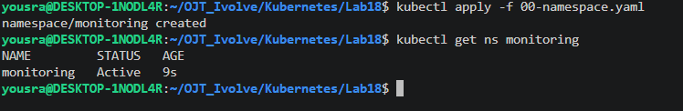

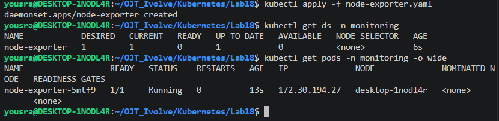

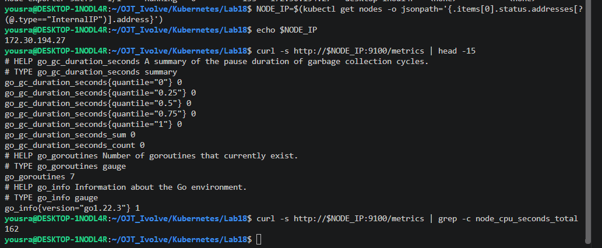

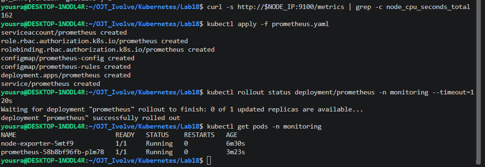

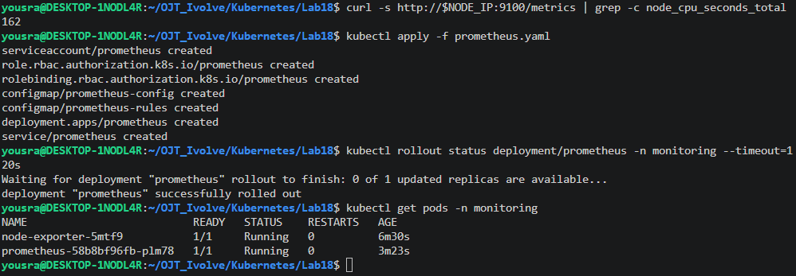

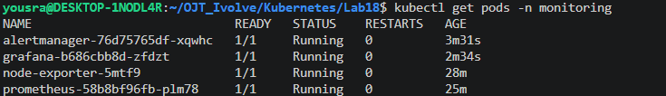

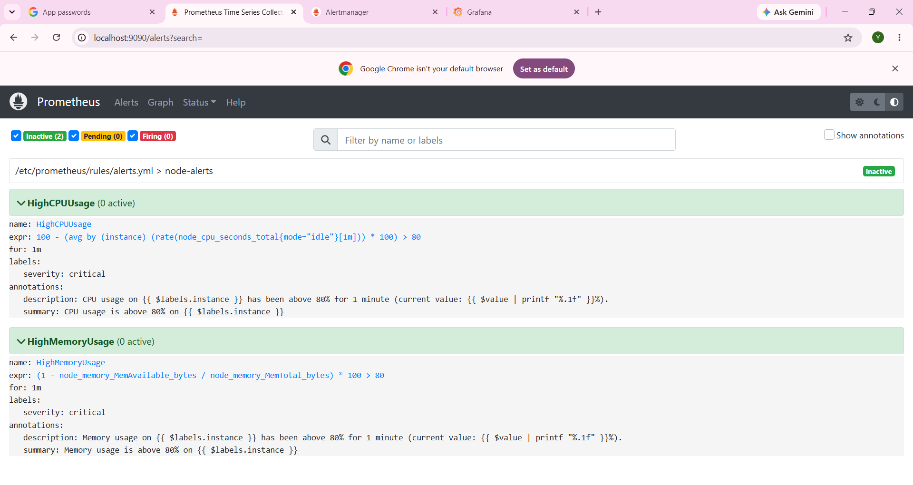

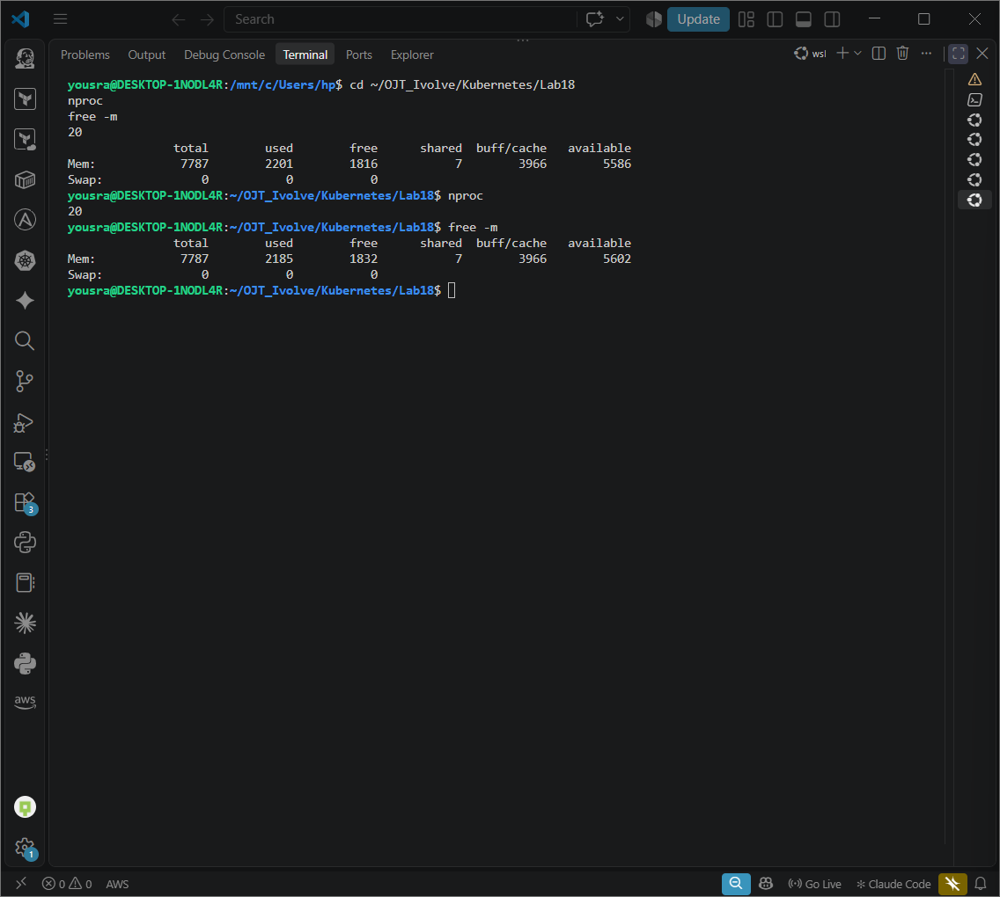

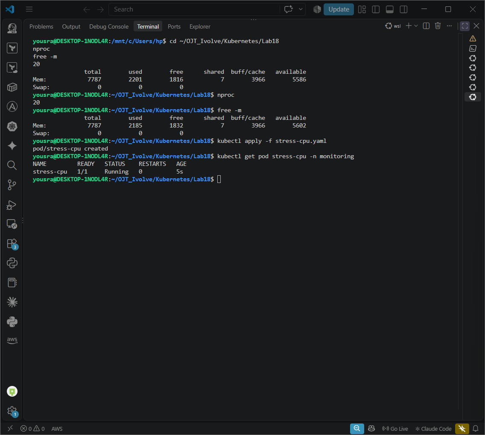

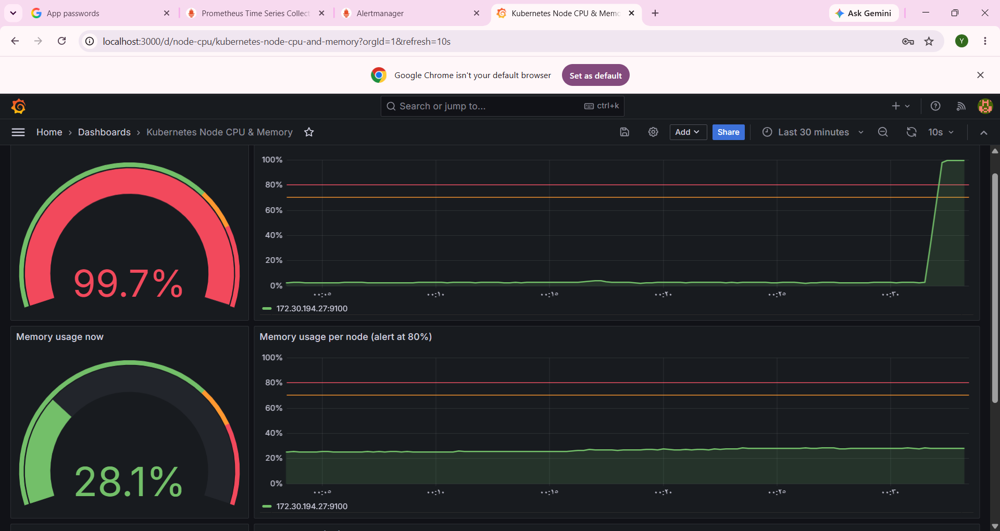

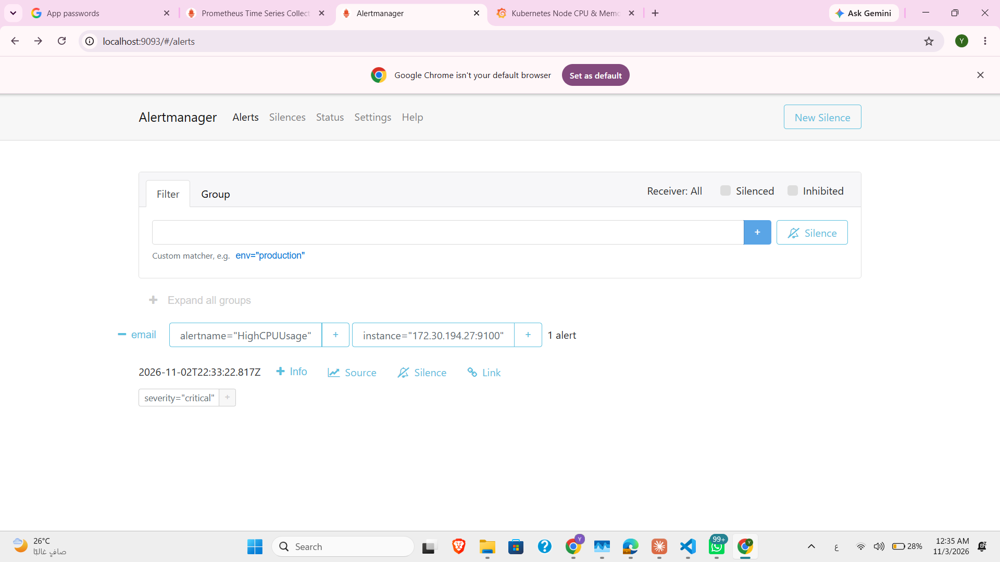

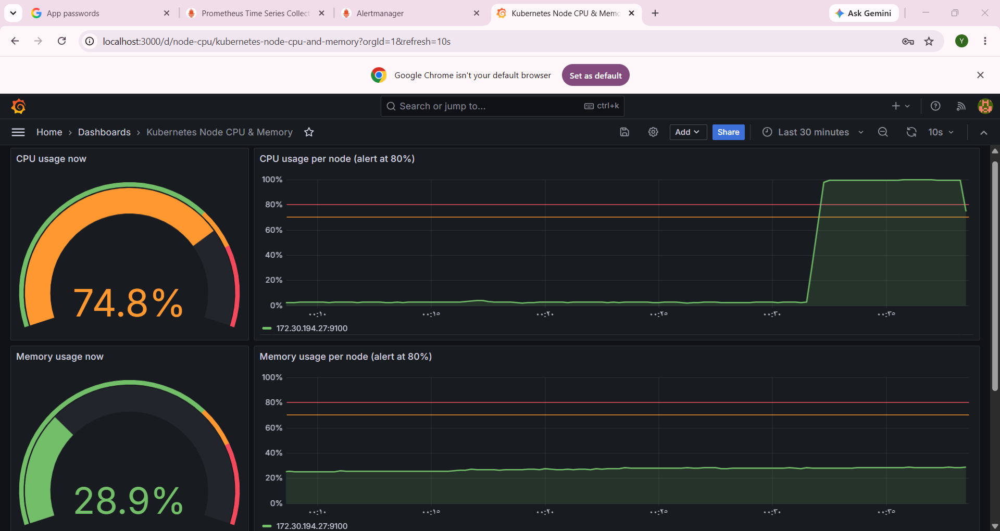


