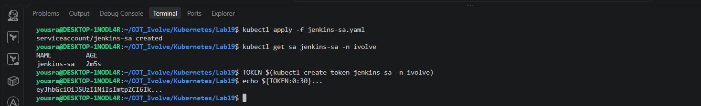
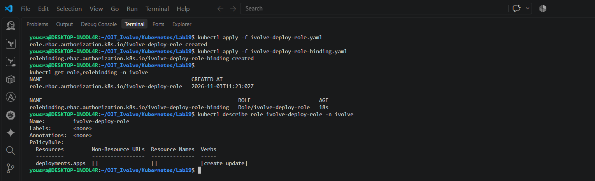
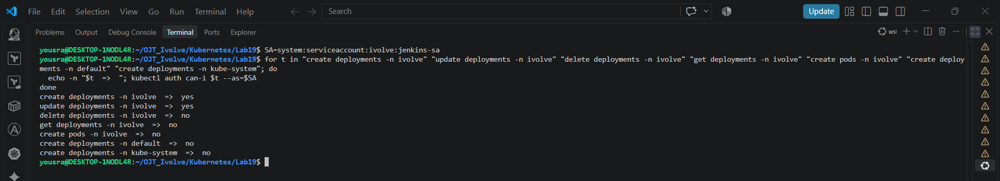
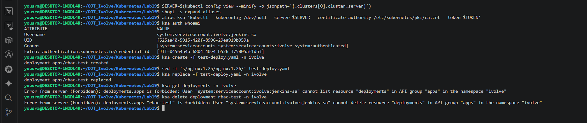
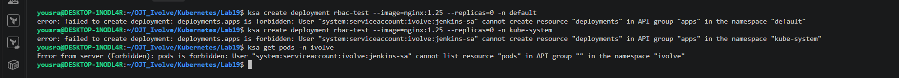

# Lab 19: Securing Kubernetes with RBAC and Service Accounts

A Service Account for Jenkins that is allowed to **create and update Deployments in the `ivolve` namespace and nothing else**. The permissions are defined with a `Role` and given to the Service Account with a `RoleBinding`.

## Files

| File | Description |
|------|-------------|
| [`jenkins-sa.yaml`](./jenkins-sa.yaml) | ServiceAccount `jenkins-sa` in the `ivolve` namespace |
| [`ivolve-deploy-role.yaml`](./ivolve-deploy-role.yaml) | Role with `create` and `update` on Deployments |
| [`ivolve-deploy-role-binding.yaml`](./ivolve-deploy-role-binding.yaml) | RoleBinding from the Role to the Service Account |
| [`test-deploy.yaml`](./test-deploy.yaml) | Deployment used only to test the permissions (`replicas: 0`) |

> **Names:** the task names the objects `jenkinsSA`, `ivolveDeployRole` and `ivolveDeployRoleBinding`. Kubernetes object names must be lowercase, so they are created as `jenkins-sa`, `ivolve-deploy-role` and `ivolve-deploy-role-binding` (the same rule applied in Labs 11 and 12).

## Step 1: Create the Service Account

```yaml
apiVersion: v1
kind: ServiceAccount
metadata:
  name: jenkins-sa
  namespace: ivolve
```

```bash
kubectl apply -f jenkins-sa.yaml
kubectl get sa jenkins-sa -n ivolve
```

```
serviceaccount/jenkins-sa created
NAME         AGE
jenkins-sa   12s
```

## Step 2: Create a token for the Service Account

```bash
TOKEN=$(kubectl create token jenkins-sa -n ivolve)
echo ${TOKEN:0:30}...
```

```
eyJhbGciOiJSUzI1NiIsImtpZCI6Ik...
```

`kubectl create token` creates a short-lived token (one hour by default; `--duration` changes it). Only the first characters are printed here, because a token is a password and must not be published.

## Step 3: Create the Role

```yaml
apiVersion: rbac.authorization.k8s.io/v1
kind: Role
metadata:
  name: ivolve-deploy-role
  namespace: ivolve
rules:
  - apiGroups: ["apps"]
    resources: ["deployments"]
    verbs: ["create", "update"]
```

```bash
kubectl apply -f ivolve-deploy-role.yaml
kubectl describe role ivolve-deploy-role -n ivolve
```

```
role.rbac.authorization.k8s.io/ivolve-deploy-role created
Name:         ivolve-deploy-role
PolicyRule:
  Resources         Non-Resource URLs  Resource Names  Verbs
  ---------         -----------------  --------------  -----
  deployments.apps  []                 []              [create update]
```

Deployments belong to the `apps` API group, so `apiGroups` is `["apps"]`. A `Role` only applies inside its own namespace.

## Step 4: Create the RoleBinding

```yaml
apiVersion: rbac.authorization.k8s.io/v1
kind: RoleBinding
metadata:
  name: ivolve-deploy-role-binding
  namespace: ivolve
subjects:
  - kind: ServiceAccount
    name: jenkins-sa
    namespace: ivolve
roleRef:
  apiGroup: rbac.authorization.k8s.io
  kind: Role
  name: ivolve-deploy-role
```

```bash
kubectl apply -f ivolve-deploy-role-binding.yaml
kubectl get role,rolebinding -n ivolve
```

```
rolebinding.rbac.authorization.k8s.io/ivolve-deploy-role-binding created
NAME                                                CREATED AT
role.rbac.authorization.k8s.io/ivolve-deploy-role   2026-11-03T10:23:53Z

NAME                                                               ROLE                      AGE
rolebinding.rbac.authorization.k8s.io/ivolve-deploy-role-binding   Role/ivolve-deploy-role   9s
```

## Step 5: Validate the permissions

### With `kubectl auth can-i`

```bash
SA=system:serviceaccount:ivolve:jenkins-sa
for t in "create deployments -n ivolve" "update deployments -n ivolve" "delete deployments -n ivolve" "get deployments -n ivolve" "create pods -n ivolve" "create deployments -n default" "create deployments -n kube-system"; do
  echo -n "$t  =>  "; kubectl auth can-i $t --as=$SA
done
```

```
create deployments -n ivolve  =>  yes
update deployments -n ivolve  =>  yes
delete deployments -n ivolve  =>  no
get deployments -n ivolve  =>  no
create pods -n ivolve  =>  no
create deployments -n default  =>  no
create deployments -n kube-system  =>  no
```

### With the real token

To really act as the Service Account, kubectl is run with the token and without the administrator credentials of the kubeconfig (`--kubeconfig=/dev/null`; otherwise the administrator certificate would still be used):

```bash
SERVER=$(kubectl config view --minify -o jsonpath='{.clusters[0].cluster.server}')
alias ksa='kubectl --kubeconfig=/dev/null --server=$SERVER --certificate-authority=/etc/kubernetes/pki/ca.crt --token=$TOKEN'
ksa auth whoami
```

```
ATTRIBUTE   VALUE
Username    system:serviceaccount:ivolve:jenkins-sa
Groups      [system:serviceaccounts system:serviceaccounts:ivolve system:authenticated]
```

Create and update a Deployment in `ivolve` (allowed), then read and delete it (not allowed):

```bash
ksa create -f test-deploy.yaml -n ivolve
sed -i 's/nginx:1.25/nginx:1.26/' test-deploy.yaml
ksa replace -f test-deploy.yaml -n ivolve
ksa get deployments -n ivolve
ksa delete deployment rbac-test -n ivolve
```

```
deployment.apps/rbac-test created
deployment.apps/rbac-test replaced
Error from server (Forbidden): deployments.apps is forbidden: User "system:serviceaccount:ivolve:jenkins-sa" cannot list resource "deployments" in API group "apps" in the namespace "ivolve"
Error from server (Forbidden): deployments.apps "rbac-test" is forbidden: User "system:serviceaccount:ivolve:jenkins-sa" cannot delete resource "deployments" in API group "apps" in the namespace "ivolve"
```

Other namespaces and other resources:

```bash
ksa create deployment rbac-test --image=nginx:1.25 --replicas=0 -n default
ksa create deployment rbac-test --image=nginx:1.25 --replicas=0 -n kube-system
ksa get pods -n ivolve
```

```
error: failed to create deployment: deployments.apps is forbidden: User "system:serviceaccount:ivolve:jenkins-sa" cannot create resource "deployments" in API group "apps" in the namespace "default"
error: failed to create deployment: deployments.apps is forbidden: User "system:serviceaccount:ivolve:jenkins-sa" cannot create resource "deployments" in API group "apps" in the namespace "kube-system"
Error from server (Forbidden): pods is forbidden: User "system:serviceaccount:ivolve:jenkins-sa" cannot list resource "pods" in API group "" in the namespace "ivolve"
```

The test Deployment is removed with the administrator account:

```bash
kubectl delete deployment rbac-test -n ivolve
```

## Result

| Action | Allowed |
|--------|---------|
| Create Deployments in `ivolve` | yes |
| Update Deployments in `ivolve` | yes |
| Delete or read Deployments in `ivolve` | no |
| Work with Pods in `ivolve` | no |
| Create Deployments in `default` or `kube-system` | no |

RBAC is deny-by-default: the Service Account can do only what a Role bound to it allows, and a `Role` is limited to its own namespace.

## Notes

- `kubectl apply` and `kubectl set image` do not work with this Role, because they use `get` and `patch`. `kubectl replace` sends a full update, which is the `update` verb. A real Jenkins pipeline that uses `kubectl apply` would also need `get` and `patch`.
- The test Deployment has `replicas: 0` so that no Pods are created and the ResourceQuota of the `ivolve` namespace (Lab 11) is not affected.

## Screenshots










