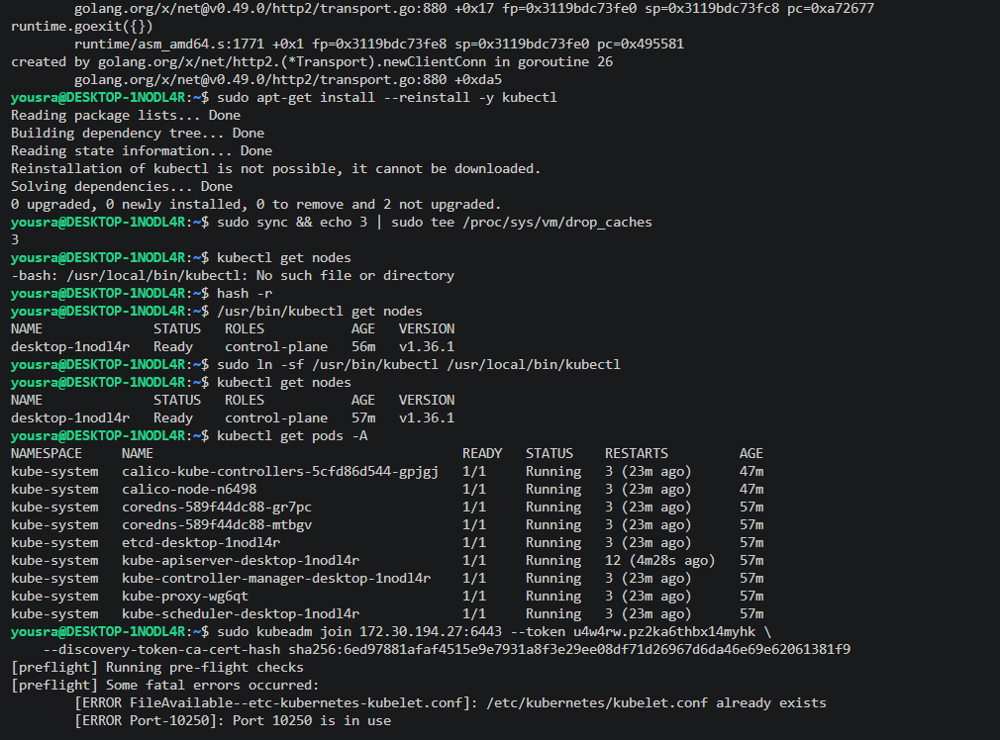
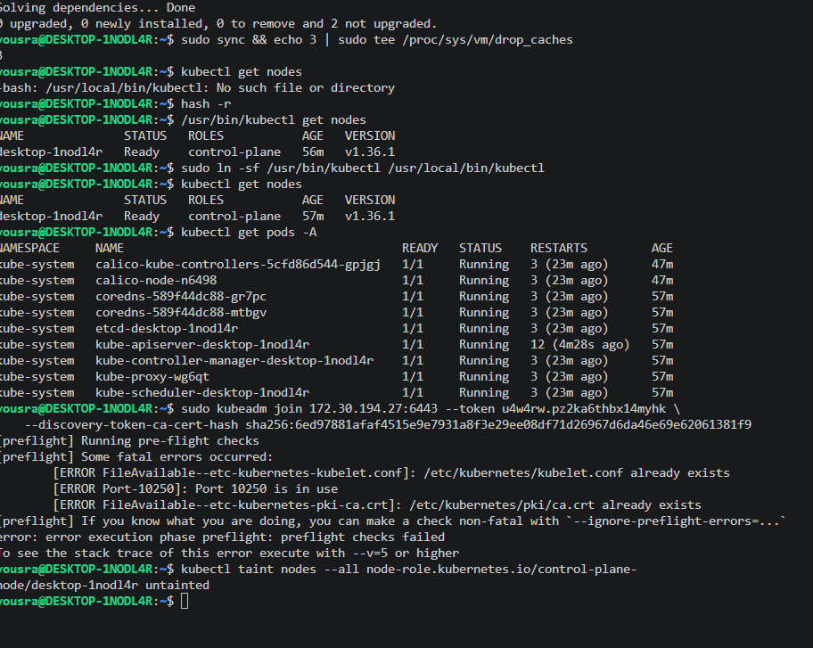
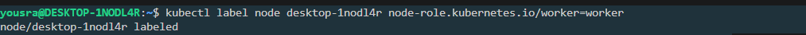
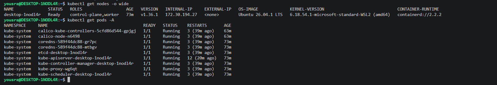

# Lab 9: Deploy a Kubernetes Cluster Using Kubeadm

A Kubernetes cluster built with `kubeadm`, using `containerd` as the container runtime and Calico as the pod network (CNI).

## Environment

| Item | Value |
|------|-------|
| Machine | WSL2 (Ubuntu 26.04 LTS), one node |
| Node name | `desktop-1nodl4r` |
| Role | `control-plane`, `worker` (one node runs both) |
| Kubernetes version | v1.36.1 |
| Container runtime | containerd 2.2.2 |
| CNI | Calico v3.27.0 |

> **Note:** this lab was done on a single node. The control-plane node also runs workloads, so the step *"join worker nodes with `kubeadm join`"* was not performed, because there was no second machine. On a cluster with separate workers, each one runs the `kubeadm join` command printed by `kubeadm init`.

## Steps

### 1. Prepare the node (all nodes)

```bash
# Disable swap
sudo swapoff -a
sudo sed -i '/ swap / s/^/#/' /etc/fstab

# Kernel modules and sysctl settings
printf 'overlay\nbr_netfilter\n' | sudo tee /etc/modules-load.d/k8s.conf
sudo modprobe overlay
sudo modprobe br_netfilter
cat <<EOF | sudo tee /etc/sysctl.d/k8s.conf
net.bridge.bridge-nf-call-iptables  = 1
net.bridge.bridge-nf-call-ip6tables = 1
net.ipv4.ip_forward                 = 1
EOF
sudo sysctl --system
```

### 2. Install containerd (all nodes)

```bash
sudo apt-get update
sudo apt-get install -y containerd
sudo mkdir -p /etc/containerd
containerd config default | sudo tee /etc/containerd/config.toml > /dev/null
sudo sed -i 's/SystemdCgroup = false/SystemdCgroup = true/' /etc/containerd/config.toml
sudo systemctl restart containerd
sudo systemctl enable containerd
```

`SystemdCgroup = true` makes containerd use the same cgroup driver as the kubelet (`systemd`).

### 3. Install kubeadm, kubelet and kubectl (control plane and workers)

```bash
sudo apt-get install -y apt-transport-https ca-certificates curl gpg
sudo mkdir -p -m 755 /etc/apt/keyrings
K8S_VERSION=v1.36
curl -fsSL https://pkgs.k8s.io/core:/stable:/$K8S_VERSION/deb/Release.key | sudo gpg --dearmor -o /etc/apt/keyrings/kubernetes-apt-keyring.gpg
echo "deb [signed-by=/etc/apt/keyrings/kubernetes-apt-keyring.gpg] https://pkgs.k8s.io/core:/stable:/$K8S_VERSION/deb/ /" | sudo tee /etc/apt/sources.list.d/kubernetes.list
sudo apt-get update
sudo apt-get install -y kubelet kubeadm kubectl
sudo apt-mark hold kubelet kubeadm kubectl
sudo systemctl enable --now kubelet
```

`apt-mark hold` prevents an accidental upgrade of the Kubernetes packages.

### 4. Initialize the control plane

```bash
sudo kubeadm init --pod-network-cidr=192.168.0.0/16
mkdir -p $HOME/.kube
sudo cp -i /etc/kubernetes/admin.conf $HOME/.kube/config
sudo chown $(id -u):$(id -g) $HOME/.kube/config
```

### 5. Install the Calico CNI

```bash
kubectl apply -f https://raw.githubusercontent.com/projectcalico/calico/v3.27.0/manifests/calico.yaml
```

Until a CNI is installed the node stays `NotReady`.

### 6. Use the single node as a worker too

By default the control-plane node has a `NoSchedule` taint, so normal pods do not run on it. Because this cluster has one node, the node is labeled as a worker and the taint is removed:

```bash
kubectl label node desktop-1nodl4r node-role.kubernetes.io/worker=worker
kubectl taint nodes desktop-1nodl4r node-role.kubernetes.io/control-plane:NoSchedule-
```

This is why the node shows `control-plane,worker` in the `ROLES` column.

### 7. Join worker nodes

On each worker, run the command printed at the end of `kubeadm init` (or create a new one on the control plane with `kubeadm token create --print-join-command`):

```bash
sudo kubeadm join <control-plane-ip>:6443 --token <token> --discovery-token-ca-cert-hash sha256:<hash>
```

Not performed successfully in this lab (single node, see the note above). Running the join command on the same machine that is already the control plane fails the pre-flight checks:

```
[ERROR FileAvailable--etc-kubernetes-kubelet.conf]: /etc/kubernetes/kubelet.conf already exists
[ERROR Port-10250]: Port 10250 is in use
[ERROR FileAvailable--etc-kubernetes-pki-ca.crt]: /etc/kubernetes/pki/ca.crt already exists
```

A worker has to be a separate machine.

## Verification

```bash
kubectl get nodes -o wide
kubectl get pods -A
```

```
NAME              STATUS   ROLES                 AGE   VERSION   INTERNAL-IP     OS-IMAGE             KERNEL-VERSION                       CONTAINER-RUNTIME
desktop-1nodl4r   Ready    control-plane,worker  73m   v1.36.1   172.30.194.27   Ubuntu 26.04.1 LTS   6.18.54.1-microsoft-standard-WSL2    containerd://2.2.2
```

```
NAMESPACE     NAME                                      READY   STATUS    RESTARTS
kube-system   calico-kube-controllers-5cfd86d44-gpjgj   1/1     Running   3
kube-system   calico-node-n6498                         1/1     Running   3
kube-system   coredns-589f44dc88-gr7pc                  1/1     Running   3
kube-system   coredns-589f44dc88-mtbgv                  1/1     Running   3
kube-system   etcd-desktop-1nodl4r                      1/1     Running   3
kube-system   kube-apiserver-desktop-1nodl4r            1/1     Running   12
kube-system   kube-controller-manager-desktop-1nodl4r   1/1     Running   3
kube-system   kube-proxy-wg6qt                          1/1     Running   3
kube-system   kube-scheduler-desktop-1nodl4r            1/1     Running   3
```

The node is `Ready` and all the control-plane components (API server, etcd, controller manager, scheduler), kube-proxy, CoreDNS and Calico are `Running`.
## Screenshots









