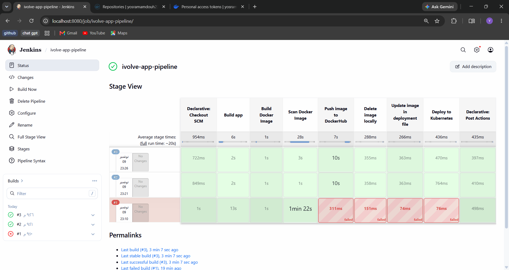
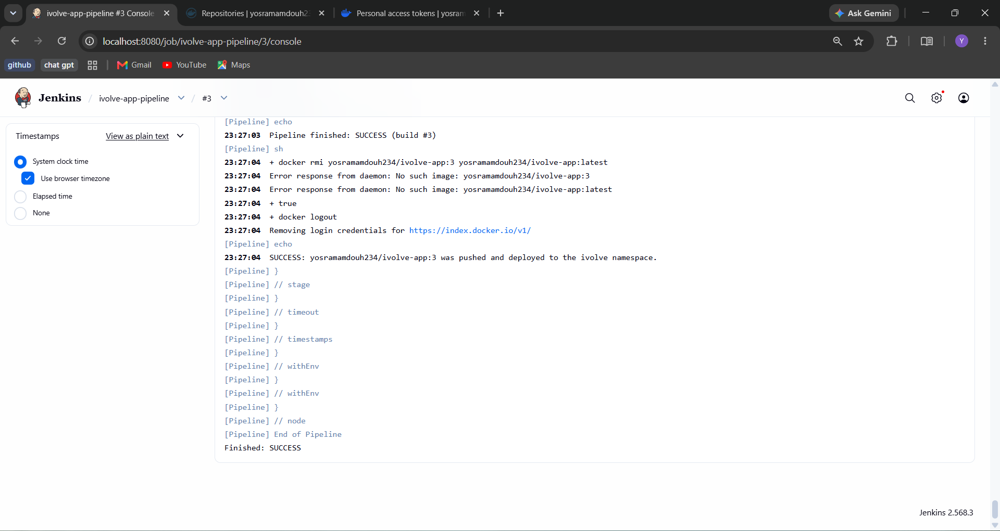
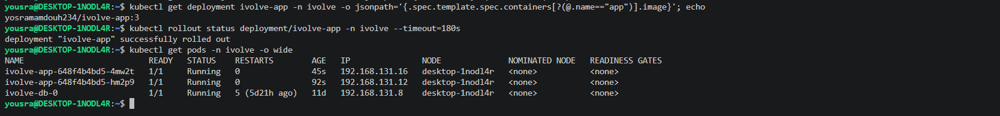
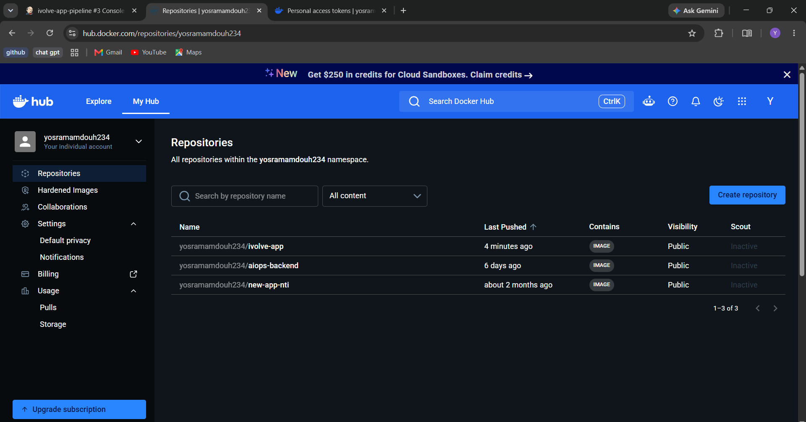

# Lab 21: Jenkins Pipeline for Application Deployment

## Goal

Create a Jenkins pipeline that automates these processes:

1. Build the app
2. Build the Docker image
3. Scan the Docker image
4. Push the image to Docker Hub
5. Delete the image locally
6. Update the image in the deployment file
7. Deploy to the Kubernetes cluster

and set the pipeline post actions `always`, `success` and `failure`.

## Source code

The instructor's note for this lab says to create a repository with the application of Lab 8 (code, Dockerfile, deployment file and a Jenkinsfile), so the same code can later be connected to Docker, Kubernetes and Jenkins (and then ArgoCD). The repository is:

**https://github.com/YosraMamdouh/Ivolve-app-cicd**

```
Ivolve-app-cicd
├── server.js, db.js, package.json, frontend/   (the Node.js application of Lab 8)
├── Dockerfile
├── k8s/
│   ├── deployment.yaml   (the Deployment of Lab 15 with the resources of Lab 16)
│   └── service.yaml
└── Jenkinsfile
```

A copy of the [`Jenkinsfile`](./Jenkinsfile) is in this folder.

## Environment

| Part | How it runs |
|------|-------------|
| Jenkins | A Docker container (Lab 20), with the Docker socket mounted, so the pipeline can use `docker` |
| Kubernetes | The kubeadm cluster of Lab 9 (single node) |
| Registry | Docker Hub, repository `yosramamdouh234/ivolve-app` |
| Job | `ivolve-app-pipeline`, type **Pipeline script from SCM** (Git, branch `*/main`, script path `Jenkinsfile`) |

The Jenkins container has no Node.js and no Trivy, so the **Build app** and **Scan** stages run them in temporary containers (`node:18-alpine` and `aquasec/trivy`) through the mounted Docker socket.

## Credentials

Two credentials were created in Jenkins (**Manage Jenkins > Credentials**). No secret is stored in the repository.

| ID | Kind | Used for |
|----|------|----------|
| `dockerhub-creds` | Username with password | `docker login` before the push |
| `k8s-jenkins-token` | Secret text | The token of the Service Account `jenkins-sa` (Lab 19) |

The token was read from the Secret `jenkins-sa-token` in the `ivolve` namespace.

## The pipeline

| # | Stage | What it does |
|:-:|-------|--------------|
| 1 | Build app | `npm install --omit=dev` and `node --check server.js` in a `node:18-alpine` container |
| 2 | Build Docker Image | `docker build`, tagged with the build number and with `latest` |
| 3 | Scan Docker Image | Trivy reports HIGH and CRITICAL vulnerabilities (`--exit-code 0`, so it reports and does not stop the pipeline) |
| 4 | Push image to DockerHub | `docker login` with `dockerhub-creds`, then `docker push` of both tags |
| 5 | Delete image locally | `docker rmi` of both tags |
| 6 | Update image in deployment file | `sed` writes the new tag in the application image line of `k8s/deployment.yaml` (the MySQL init container is not touched) |
| 7 | Deploy to Kubernetes | `kubectl replace -f k8s/deployment.yaml` with the token of `jenkins-sa` |

Post actions:

| Post action | What it does |
|-------------|--------------|
| `always` | Prints the result, removes the image if it is still there, and runs `docker logout` |
| `success` | Prints that the image was pushed and deployed |
| `failure` | Prints that the pipeline failed |

### Why `kubectl replace`

In Lab 19 the Role of `jenkins-sa` allows only **create** and **update** on Deployments. `kubectl replace` sends an update (PUT), so it is allowed. `kubectl apply` and `kubectl set image` need `get` and `patch`, which are forbidden by that Role.

### Image tag

The tag is the Jenkins `BUILD_NUMBER`, so every build gives a different image and the Deployment changes at every run. The tag `latest` is pushed too.

## Results

### Build #1 (failed)

The first build reached the scan stage and failed in **Push image to DockerHub**, because the credential `dockerhub-creds` did not exist yet. After creating the two credentials the pipeline was run again.

### Build #3 (success)

The end of the console output of build #3:

```
+ grep -n image: k8s/deployment.yaml
30:          image: mysql:8.0
51:          image: yosramamdouh234/ivolve-app:3
...
+ kubectl --kubeconfig=/dev/null --server=https://172.30.194.27:6443 --insecure-skip-tls-verify=true --token=**** -n ivolve replace -f k8s/deployment.yaml
deployment.apps/ivolve-app replaced
...
Pipeline finished: SUCCESS (build #3)
+ docker rmi yosramamdouh234/ivolve-app:3 yosramamdouh234/ivolve-app:latest
Error response from daemon: No such image: yosramamdouh234/ivolve-app:3
Error response from daemon: No such image: yosramamdouh234/ivolve-app:latest
+ true
+ docker logout
Removing login credentials for https://index.docker.io/v1/
SUCCESS: yosramamdouh234/ivolve-app:3 was pushed and deployed to the ivolve namespace.
Finished: SUCCESS
```

The "No such image" messages in the `always` block are expected: stage 5 already deleted the images, and the command ends with `|| true`.





### Check on the cluster

```bash
kubectl get deployment ivolve-app -n ivolve -o jsonpath='{.spec.template.spec.containers[?(@.name=="app")].image}'; echo
```
```
yosramamdouh234/ivolve-app:3
```

```bash
kubectl rollout status deployment/ivolve-app -n ivolve --timeout=180s
```
```
deployment "ivolve-app" successfully rolled out
```

```bash
kubectl get pods -n ivolve -o wide
```
```
NAME                          READY   STATUS    RESTARTS        AGE   IP               NODE              NOMINATED NODE   READINESS GATES
ivolve-app-648f4b4bd5-4mw2t   1/1     Running   0               45s   192.168.131.16   desktop-1nodl4r   <none>           <none>
ivolve-app-648f4b4bd5-hm2p9   1/1     Running   0               92s   192.168.131.12   desktop-1nodl4r   <none>           <none>
ivolve-db-0                   1/1     Running   5 (5d21h ago)   11d   192.168.131.8    desktop-1nodl4r   <none>           <none>
```



### Docker Hub

The tags of the build were pushed to `yosramamdouh234/ivolve-app`.



## Notes

- The Trivy stage only **reports** (`--exit-code 0`). Changing it to `--exit-code 1` makes the pipeline fail when HIGH or CRITICAL vulnerabilities are found; the `node:18-alpine` base image currently has some, so it would stop the pipeline.
- `--insecure-skip-tls-verify=true` is used in the Deploy stage because the CA certificate is not available inside the Jenkins container. For a real environment, mount the CA file and use `--certificate-authority`.
- The e-mail notification on success and failure is not part of this lab, so it is not configured. The post actions print the result in the console.
