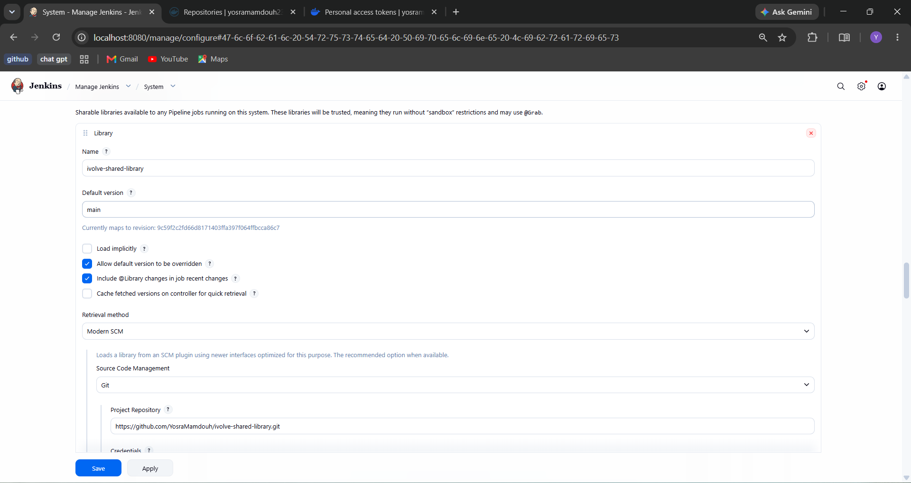
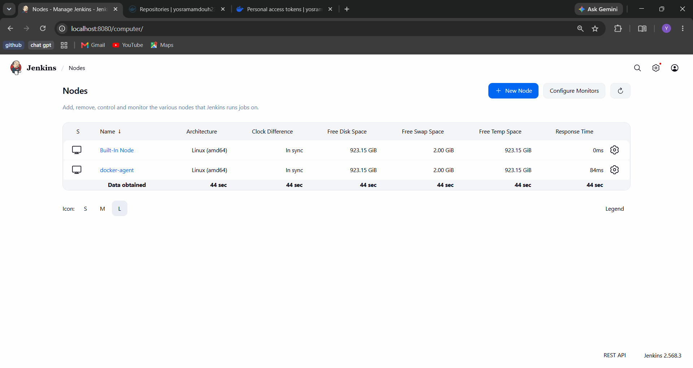
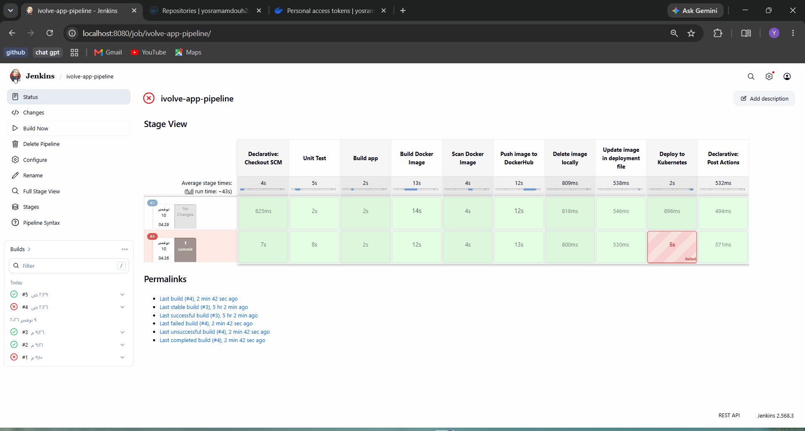
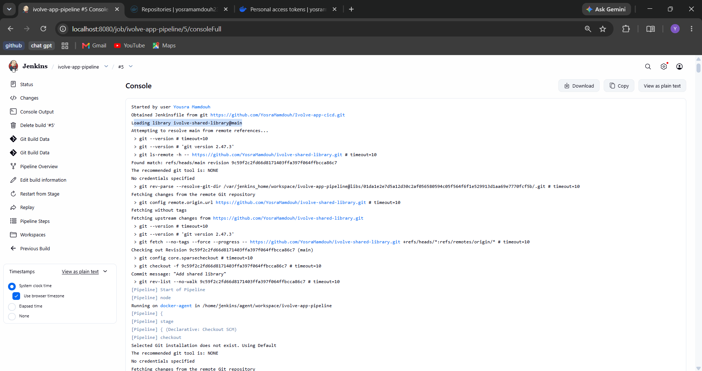
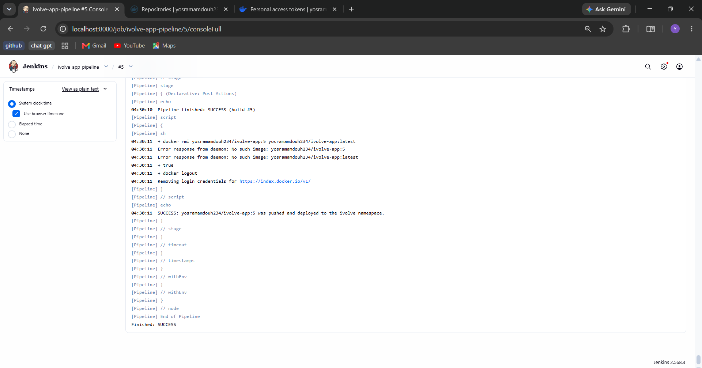
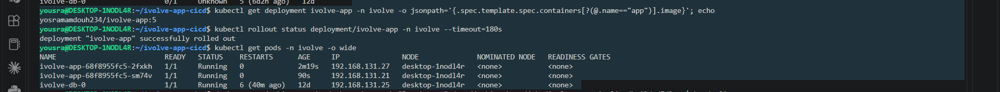

# Lab 22: CI/CD Pipeline Implementation with Jenkins Agents and Shared Libraries

## Goal

- Create three shared libraries:
  1. **BuildApp**: unit test, build the app
  2. **BuildImage**: build the image, scan it, push it, delete it locally
  3. **DeployOnK8s**: edit the deployment file, deploy to the cluster
- Update the pipeline to use them.
- Configure a Jenkins agent (slave) to run the pipeline.

## Source code

As in Lab 21, the application is the one of Lab 8 (with its Dockerfile) in:

**https://github.com/YosraMamdouh/Ivolve-app-cicd**

The shared libraries are in their own repository:

**https://github.com/YosraMamdouh/ivolve-shared-library**

```
ivolve-shared-library
└── vars
    ├── buildApp.groovy
    ├── buildImage.groovy
    └── deployOnK8s.groovy
```

Copies of the files are in this folder: [`vars/`](./vars) and [`Jenkinsfile`](./Jenkinsfile).

## The shared libraries

Each file in `vars/` is a global variable with methods, so the pipeline calls them as `buildApp.test()`, `buildImage.push(...)` and so on.

| Library | Methods | What they do |
|---------|---------|--------------|
| `buildApp` | `test()`, `build()` | `npm test --if-present` (it runs only when `package.json` has a test script), then `npm install --omit=dev` and `node --check server.js`. Both run in a temporary `node:18-alpine` container because the agent has no Node.js |
| `buildImage` | `build()`, `scan()`, `push()`, `delete()`, `cleanup()` | `docker build` with the build number and `latest` tags, Trivy scan of HIGH and CRITICAL vulnerabilities (report only), `docker login` and `docker push` with the `dockerhub-creds` credential, `docker rmi`, and a `cleanup()` that never fails (used in `post`) |
| `deployOnK8s` | `updateImage()`, `deploy()` | `sed` writes the new tag in `k8s/deployment.yaml`, then `kubectl replace` with the `jenkins-sa` token from the `k8s-jenkins-token` credential |

The libraries contain only the steps. The `stage { }` blocks stay in the `Jenkinsfile`, because a declarative pipeline does not allow stages inside a step.

### Registering the library in Jenkins

In **Manage Jenkins > System > Global Trusted Pipeline Libraries**:

| Setting | Value |
|---------|-------|
| Name | `ivolve-shared-library` |
| Default version | `main` |
| Retrieval method | Modern SCM, Git |
| Project Repository | `https://github.com/YosraMamdouh/ivolve-shared-library.git` |

Jenkins showed `Currently maps to revision: 9c59f2c...`, which is the commit of the library repository, so it could read the repository.



## The Jenkins agent

The agent is a Docker container that connects to the Jenkins controller over WebSocket.

**1) Create the node** in **Manage Jenkins > Nodes > New Node**:

| Setting | Value |
|---------|-------|
| Name | `docker-agent` |
| Type | Permanent Agent |
| Remote root directory | `/home/jenkins/agent` |
| Labels | `docker-agent` |
| Launch method | Launch agent by connecting it to the controller |

**2) Run the agent container.** Jenkins shows the secret of the node on its page. The secret is read into a variable and is not stored in any file.

```bash
read -rp "Agent secret: " SECRET
docker volume create agent_work
docker run -d --name jenkins-agent --restart unless-stopped \
  --group-add "$(stat -c %g /var/run/docker.sock)" \
  -v agent_work:/home/jenkins/agent \
  -v /var/run/docker.sock:/var/run/docker.sock \
  -v /usr/bin/docker:/usr/bin/docker \
  -v "$(which kubectl)":/usr/local/bin/kubectl \
  -e JENKINS_URL=http://172.30.194.27:8080/ \
  -e JENKINS_AGENT_NAME=docker-agent \
  -e JENKINS_SECRET="$SECRET" \
  -e JENKINS_WEB_SOCKET=true \
  jenkins/inbound-agent:latest
unset SECRET
```

- `127.0.0.1` (the address shown by Jenkins) cannot be used because inside a container it points to the container itself, so the IP of the machine is used.
- The Docker socket and the `docker` and `kubectl` binaries are mounted, so the pipeline can build images and deploy.
- The workspace is stored in the volume `agent_work`, mounted at `/home/jenkins/agent`. The temporary `node:18-alpine` container mounts the same volume to see the workspace.

**3) Check the agent:**

```bash
docker logs --tail 6 jenkins-agent
```
```
INFO: WebSocket connection open
INFO: Connected
```

```bash
docker exec jenkins-agent sh -c 'docker ps >/dev/null && echo "docker OK"; kubectl version --client | head -1'
```
```
docker OK
Client Version: v1.36.1
```



## The pipeline

The `Jenkinsfile` loads the library with `@Library('ivolve-shared-library') _`, runs on the agent with `agent { label 'docker-agent' }`, and calls the libraries in its stages:

| Stage | Call |
|-------|------|
| Unit Test | `buildApp.test()` |
| Build app | `buildApp.build()` |
| Build Docker Image | `buildImage.build(...)` |
| Scan Docker Image | `buildImage.scan(...)` |
| Push image to DockerHub | `buildImage.push(...)` |
| Delete image locally | `buildImage.delete(...)` |
| Update image in deployment file | `deployOnK8s.updateImage(...)` |
| Deploy to Kubernetes | `deployOnK8s.deploy(...)` |

The post actions `always`, `success` and `failure` are the same as in Lab 21.

## Results

### Build #4 (failed)

All the stages before the deployment passed, and **Deploy to Kubernetes** failed because the Kubernetes API server was not running (the cluster had been stopped with WSL):

```
error: error validating "k8s/deployment.yaml": error validating data: failed to download openapi: Get "https://172.30.194.27:6443/openapi/v2?timeout=32s": dial tcp 172.30.194.27:6443: connect: connection refused
```

After starting the cluster again (`sudo systemctl restart containerd` and `kubelet`), the pipeline was run again.

### Build #5 (success)

The build ran on the agent:

```
Running on docker-agent in /home/jenkins/agent/workspace/ivolve-app-pipeline
```

The end of the console output:

```
+ docker push yosramamdouh234/ivolve-app:5
5: digest: sha256:d6876881cab344bb7869166dafe73b0e18558b2f22c1764efff902009a420bbb size: 2056
+ docker push yosramamdouh234/ivolve-app:latest
latest: digest: sha256:d6876881cab344bb7869166dafe73b0e18558b2f22c1764efff902009a420bbb size: 2056
+ docker rmi yosramamdouh234/ivolve-app:5 yosramamdouh234/ivolve-app:latest
Untagged: yosramamdouh234/ivolve-app:5
Untagged: yosramamdouh234/ivolve-app:latest
+ grep -n image: k8s/deployment.yaml
30:          image: mysql:8.0
51:          image: yosramamdouh234/ivolve-app:5
+ kubectl ... -n ivolve replace -f k8s/deployment.yaml
deployment.apps/ivolve-app replaced
Pipeline finished: SUCCESS (build #5)
SUCCESS: yosramamdouh234/ivolve-app:5 was pushed and deployed to the ivolve namespace.
Finished: SUCCESS
```







### Check on the cluster

```bash
kubectl get deployment ivolve-app -n ivolve -o jsonpath='{.spec.template.spec.containers[?(@.name=="app")].image}'; echo
```
```
yosramamdouh234/ivolve-app:5
```

```bash
kubectl rollout status deployment/ivolve-app -n ivolve --timeout=180s
```
```
deployment "ivolve-app" successfully rolled out
```

```bash
kubectl get pods -n ivolve -o wide
```
```
NAME                          READY   STATUS    RESTARTS      AGE     IP               NODE              NOMINATED NODE   READINESS GATES
ivolve-app-68f8955fc5-2fxkh   1/1     Running   0             2m19s   192.168.131.27   desktop-1nodl4r   <none>           <none>
ivolve-app-68f8955fc5-sm74v   1/1     Running   0             90s     192.168.131.21   desktop-1nodl4r   <none>           <none>
ivolve-db-0                   1/1     Running   6 (40m ago)   12d     192.168.131.25   desktop-1nodl4r   <none>           <none>
```



## Notes

- Changing the code of a library does not need a change in the `Jenkinsfile`: Jenkins reads the library from GitHub (branch `main`) at the start of every build.
- The agent secret and the credentials are not stored in the repositories.
- The shared libraries are used again in Lab 23, where `deployOnK8s` is changed to push the edited deployment file to GitHub.
