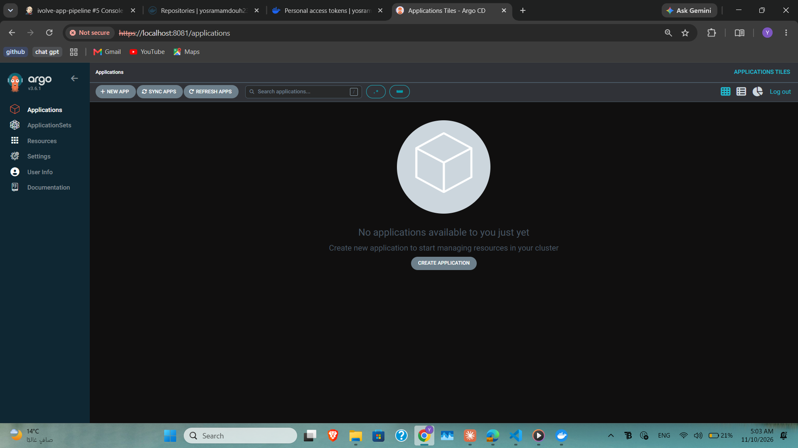
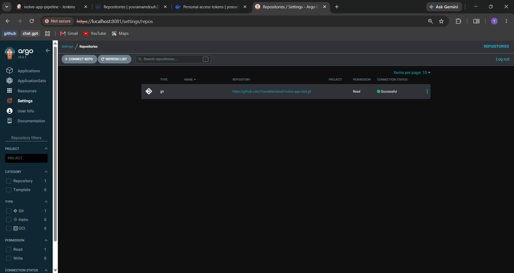
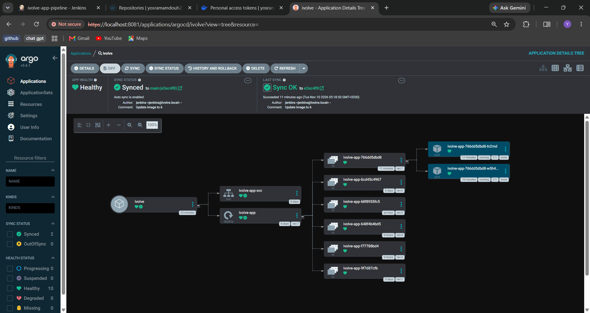
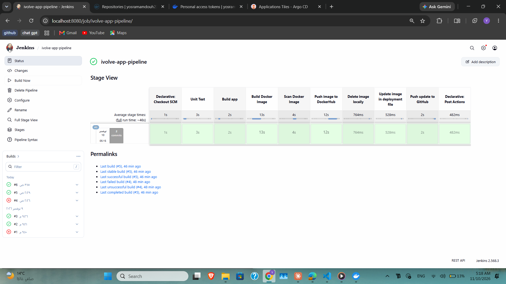
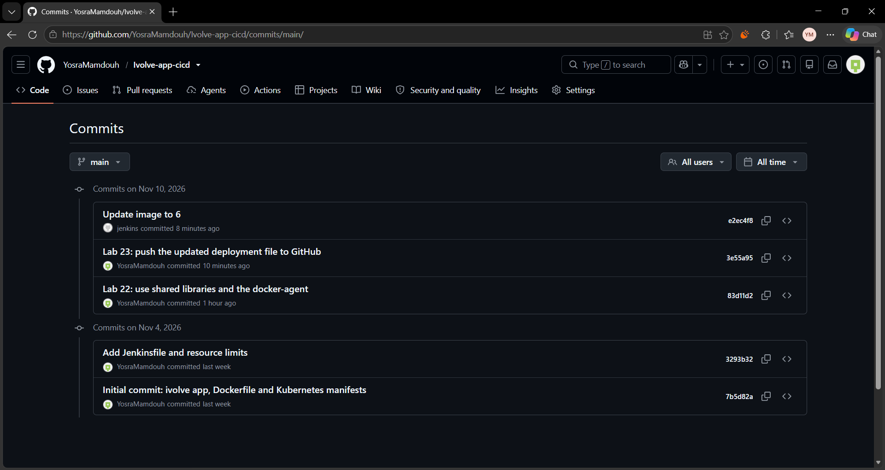
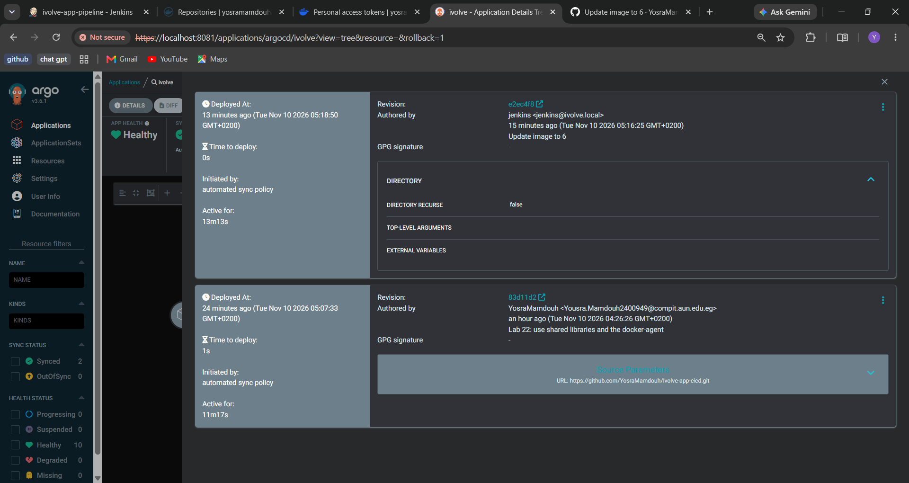

# Lab 23: Implementing a GitOps Workflow with Jenkins and Argo CD

## Goal

- Install Argo CD in the Kubernetes cluster and log in to its UI.
- Connect Argo CD to the GitHub repository.
- Create an Argo CD Application, watching the manifest directory, with automatic synchronization.
- Change the `DeployOnK8s` library so Jenkins pushes the edited deployment file to GitHub.
- Run the Jenkins pipeline and confirm that Argo CD detects the change and synchronizes the application.

## How it works

```
Jenkins (build #N)                         GitHub                         Argo CD                  Kubernetes
build + scan + push image  ──►  commit "Update image to N"  ──►  detects the change in k8s/  ──►  Deployment ivolve-app
edit k8s/deployment.yaml          (Ivolve-app-cicd, main)           and syncs automatically        runs ivolve-app:N
```

Jenkins no longer talks to the cluster. The Git repository is the source of truth, and Argo CD applies it.

| Part | Repository or place |
|------|---------------------|
| Application and manifests | https://github.com/YosraMamdouh/Ivolve-app-cicd (`k8s/`) |
| Shared libraries | https://github.com/YosraMamdouh/ivolve-shared-library |

## 1) Install Argo CD

```bash
kubectl create namespace argocd
kubectl apply -n argocd --server-side --force-conflicts -f https://raw.githubusercontent.com/argoproj/argo-cd/stable/manifests/install.yaml
```

The node has the taint `workload=ivolveApp:NoSchedule` from Lab 10, so Pods without a toleration stay `Pending`. A toleration was added to every Deployment and StatefulSet of Argo CD:

```bash
for r in $(kubectl get deploy,sts -n argocd -o name); do kubectl patch $r -n argocd --type=json -p='[{"op":"add","path":"/spec/template/spec/tolerations","value":[{"operator":"Exists"}]}]'; done
```

The Pod of the StatefulSet `argocd-application-controller-0` stayed `Pending` with the old spec, so it was deleted and the StatefulSet created it again with the toleration:

```bash
kubectl delete pod argocd-application-controller-0 -n argocd
```

```bash
kubectl get pods -n argocd
```
```
NAME                                                READY   STATUS    RESTARTS   AGE
argocd-application-controller-0                     1/1     Running   0          19m
argocd-applicationset-controller-6ccfd548b7-66tsl   1/1     Running   0          26m
argocd-dex-server-6cb7b4c9f4-zlpq8                  1/1     Running   0          26m
argocd-notifications-controller-585bfdfbdf-m9wr8    1/1     Running   0          26m
argocd-redis-66f5f6f97b-6nvlk                       1/1     Running   0          26m
argocd-repo-server-84d4657f9c-79xm7                 1/1     Running   0          26m
argocd-server-8685d4bdc7-ncm2h                      1/1     Running   0          26m
```


## 2) Access the UI

The initial password of the user `admin` is stored in a Secret:

```bash
kubectl -n argocd get secret argocd-initial-admin-secret -o jsonpath="{.data.password}" | base64 -d; echo
```

The UI is reached with a port forward (port 8080 is used by Jenkins, so 8081 is used):

```bash
kubectl port-forward svc/argocd-server -n argocd 8081:443
```

Then open `https://localhost:8081` (the certificate is self-signed, so the browser shows a warning) and log in as `admin`.



## 3) Connect the GitHub repository

In **Settings > Repositories > Connect Repo**: method HTTPS, type `git`, project `default`, URL `https://github.com/YosraMamdouh/Ivolve-app-cicd.git`.



## 4) Create the Application

The Application is in [`argocd-application.yaml`](./argocd-application.yaml):

```yaml
apiVersion: argoproj.io/v1alpha1
kind: Application
metadata:
  name: ivolve
  namespace: argocd
spec:
  project: default
  source:
    repoURL: https://github.com/YosraMamdouh/Ivolve-app-cicd.git
    targetRevision: main
    path: k8s
  destination:
    server: https://kubernetes.default.svc
    namespace: ivolve
  syncPolicy:
    automated:
      prune: true
      selfHeal: true
```

- `path: k8s` is the manifest directory (`deployment.yaml` and `service.yaml`).
- `automated` is the automatic synchronization: a change in Git is applied to the cluster without a manual sync. `selfHeal` reverts manual changes in the cluster, and `prune` deletes resources that were removed from Git.
- The task writes the name as `ivovle`; the name `ivolve` is used, like the rest of the course.

```bash
kubectl apply -f argocd-application.yaml
kubectl get applications -n argocd
```
```
application.argoproj.io/ivolve created
NAME     SYNC STATUS   HEALTH STATUS
ivolve   Synced        Progressing
```

The first synchronization applied the `k8s/` folder as it was in Git. The Deployment in Git still had the image `ivolve-app:v1` (Jenkins used to edit the file only in its workspace), so Argo CD rolled the Deployment to `v1`:

```
NAME                          READY   STATUS        RESTARTS      AGE
ivolve-app-68f8955fc5-2fxkh   1/1     Terminating   0             37m
ivolve-app-6cd45c4967-fw9fm   1/1     Running       0             14s
ivolve-db-0                   1/1     Running       6 (75m ago)   12d
```

```
NAME     SYNC STATUS   HEALTH STATUS
ivolve   Synced        Healthy
```
```
yosramamdouh234/ivolve-app:v1
```



## 5) Change the `DeployOnK8s` library

In [`vars/deployOnK8s.groovy`](./vars/deployOnK8s.groovy) the `deploy()` method (which ran `kubectl replace`) was replaced by `pushToGit()`:

| Method | What it does |
|--------|--------------|
| `updateImage(image, tag)` | `sed` writes the new tag in the application image line of `k8s/deployment.yaml` |
| `pushToGit(repoPath, tag)` | `git add` of the file, `git commit -m "Update image to <tag>"`, and `git push` to `main` with the credential `github-creds` |

A credential `github-creds` (Username with password) was added in Jenkins; the password is a GitHub Personal Access Token with the `repo` scope. The token is not stored in any repository.

The [`Jenkinsfile`](./Jenkinsfile) now ends with the stage **Push update to GitHub** instead of **Deploy to Kubernetes**, and the variables `K8S_SERVER` and `K8S_NAMESPACE` were removed.

## 6) Run the pipeline

Jenkins build #6 built and scanned the image, pushed `yosramamdouh234/ivolve-app:6` to Docker Hub, edited the deployment file, and pushed it to GitHub.



**On GitHub**, the repository has the new commit made by Jenkins:

```bash
git fetch origin && git log origin/main --oneline | head -5
```
```
e2ec4f8 Update image to 6
3e55a95 Lab 23: push the updated deployment file to GitHub
83d11d2 Lab 22: use shared libraries and the docker-agent
3293b32 Add Jenkinsfile and resource limits
7b5d82a Initial commit: ivolve app, Dockerfile and Kubernetes manifests
```
```bash
git show origin/main:k8s/deployment.yaml | grep -n "image:"
```
```
30:          image: mysql:8.0
51:          image: yosramamdouh234/ivolve-app:6
```



**In the cluster**, Argo CD applied the change (Jenkins did not run any `kubectl` command in this build):

```bash
kubectl get deployment ivolve-app -n ivolve -o jsonpath='{.spec.template.spec.containers[?(@.name=="app")].image}'; echo
```
```
yosramamdouh234/ivolve-app:6
```
```bash
kubectl get applications -n argocd
```
```
NAME     SYNC STATUS   HEALTH STATUS
ivolve   Synced        Progressing
```
```bash
kubectl rollout status deployment/ivolve-app -n ivolve --timeout=180s
```
```
Waiting for deployment "ivolve-app" rollout to finish: 1 out of 2 new replicas have been updated...
Waiting for deployment "ivolve-app" rollout to finish: 1 of 2 updated replicas are available...
deployment "ivolve-app" successfully rolled out
```
```bash
kubectl get pods -n ivolve -o wide
```
```
NAME                          READY   STATUS    RESTARTS      AGE   IP               NODE              NOMINATED NODE   READINESS GATES
ivolve-app-766dd5dbd8-ln2md   1/1     Running   0             57s   192.168.131.31   desktop-1nodl4r   <none>           <none>
ivolve-app-766dd5dbd8-w5h4m   1/1     Running   0             6s    192.168.131.39   desktop-1nodl4r   <none>           <none>
ivolve-db-0                   1/1     Running   6 (87m ago)   12d   192.168.131.25   desktop-1nodl4r   <none>           <none>
```

The `Progressing` status was taken while the rollout was still running. The new Pods are `Running` after it finished.

The **History and Rollback** tab of the Application shows the revisions that Argo CD synchronized:



## Notes

- Git is now the source of truth. A manual change in the cluster (for example `kubectl edit`) is reverted by `selfHeal`, and the right way to change the application is a commit in `k8s/`.
- A rollback is a `git revert` of the commit made by Jenkins (or the **Rollback** button in the Argo CD UI, which needs automatic sync to be disabled first).
- The Argo CD admin password was read from the initial Secret and is not stored in any repository.
